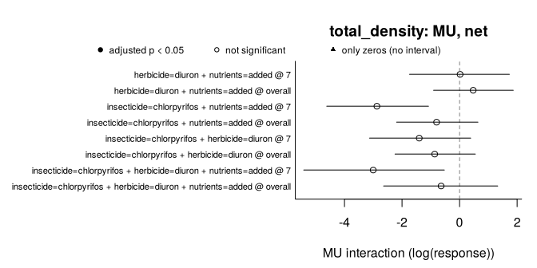

<!-- README.md is generated from README.Rmd. Edit README.Rmd and render it with rmarkdown::render("README.Rmd") after installing the package. -->

# must

<!-- badges: start -->

[](https://github.com/pabloamadorc/must/actions/workflows/R-CMD-check.yaml)
<!-- badges: end -->

**must** (*MUltiple STressors*) detects and classifies non-additive
effects of multiple stressors in experiments. It makes explicit the
three decisions behind any claim of synergism or antagonism:

1.  **What the design can identify.** `describe_design()` reports
    missing treatment combinations, cells shared by several contrasts,
    the replication unit, stressors applied to whole groups of units
    (blocks, whole plots, rooms) and repeated measures, and which
    interactions are identifiable, before any model is fitted.
2.  **Which model fits the data.** `fit_responses()` fits a generalised
    linear mixed model (glmmTMB) to each response and chooses its error
    distribution by convergence, simulation-based residual checks
    (DHARMa) and AIC.
3.  **What “non-additive” means.** `estimate_interactions()` tests the
    simple addition (AD), multiplicative (MU) and dominance (DO) null
    models from the predictions of that single model (post-estimation
    inference, Madge Pimentel et al. 2025), by default with a correction
    for experiments with few replicates. With three or more stressors it
    separates the net deviation from the single-stressor effects from
    the pure highest-order interaction. `classify_interactions()` gives
    the directional classes of Piggott et al. (2015).

Orr et al. (2020) name the use of null models as a major unresolved
issue in multiple-stressor research and ask researchers to know the
alternatives and how each relates to a statistical test; must is built
to report them side by side.

> **Status:** version 0.1.0, not yet on CRAN. The interface may still
> change.

## Installation

``` r
# install.packages("remotes")
remotes::install_github("pabloamadorc/must")
# The residual checks used to choose each model need DHARMa:
install.packages("DHARMa")
```

## Example

`polazzo_zooplankton` holds the zooplankton of a mesocosm experiment
with a full factorial of an insecticide, a herbicide and nutrients,
three mesocosms per combination, sampled four times after the pesticide
application (Polazzo & Rico 2021, CC0).

``` r
library(must)
zoo <- polazzo_zooplankton[polazzo_zooplankton$day > 0, ]

design <- describe_design(
  zoo,
  stressors = c("insecticide", "herbicide", "nutrients"),
  control = c(insecticide = "absent", herbicide = "absent", nutrients = "ambient"),
  unit = "mesocosm",
  time = "day"
)
design
#> <must_design> 96 rows, 3 stressors, 8 observed treatment combinations
#> Stressors (control): insecticide (absent), herbicide (absent), nutrients (ambient)
#> Unit: mesocosm | Time: day | By: none | Groups: none
#> Contrast sets: 4 candidate(s), 4 identifiable
#> Checks:
#>   info     Experimental unit: 'mesocosm' (24 units, each in a single
#>            treatment combination).
#>   info     Units per treatment combination: 3.
#>   info     Units are measured repeatedly (4 sampling times; 4 per unit).
#>            Samplings of the same unit are not independent: by default
#>            fit_responses() adds a random intercept per unit, which assumes
#>            the same correlation between any two samplings of a unit;
#>            temporal autocorrelation can be modelled through its `random`
#>            argument.
#>   info     Identifiable contrast sets (net deviation): 3 with 2 stressors;
#>            1 with 3 stressors.
#>   info     4 identifiable set(s) share cells (one cell is used by up to 4
#>            sets, typically the control): their estimates are correlated,
#>            not independent replicates of an interaction.
```

One model per response. `residual_checks = TRUE` (the default) uses
DHARMa; it is switched off here only so that this example runs without
it.

``` r
fits <- fit_responses(zoo, c("total_density", "cyclopoida", "daphnia"), design,
                      residual_checks = FALSE, seed = 1, quiet = TRUE)
fits
#> <must_fit> 3 response(s); time structure: interaction; dispersion: common; random effects: (1 | .unit)
#> Residual checks: not run; seed: 1
#>   total_density: gamma_log (log link; continuous, detected), AIC 1311.9, n = 96, missing = 0, residual checks: not run
#>   cyclopoida: tweedie (log link; continuous, detected), AIC 927.8, n = 96, missing = 0, residual checks: not run
#>   daphnia: tweedie (log link; continuous, detected), AIC 410.0, n = 96, missing = 0, residual checks: not run
```

Interactions under the three null models, with Krinsky–Robb intervals
and the small-sample correction (the default):

``` r
est <- estimate_interactions(fits, n_sim = 4000, seed = 2021)
summary(est)
#> Interactions: Krinsky-Robb simulation; small-sample correction; adjusted p-values (BH) below 0.05
#> Deviating / tested interactions by sampling time:
#>       response model estimand   7  14  30  50 overall
#>  total_density    AD      net 0/4 0/4 0/4 0/4     0/4
#>  total_density    MU      net 0/4 0/4 0/4 0/4     0/4
#>  total_density    DO      net 0/3 0/3 0/3 0/3     0/3
#>  total_density    AD     pure 0/1 0/1 0/1 0/1     0/1
#>  total_density    MU     pure 0/1 0/1 0/1 0/1     0/1
#>     cyclopoida    AD      net 0/4 0/4 0/4 0/4     0/4
#>     cyclopoida    MU      net 0/4 0/4 0/4 0/4     0/4
#>     cyclopoida    DO      net 0/3 0/3 0/3 0/3     0/3
#>     cyclopoida    AD     pure 0/1 0/1 0/1 0/1     0/1
#>     cyclopoida    MU     pure 0/1 0/1 0/1 0/1     0/1
#>        daphnia    AD      net 0/1 0/0 0/1 0/1     0/0
#>        daphnia    MU      net 0/1 0/0 0/1 0/1     0/0
#>        daphnia    DO      net 0/1 0/0 0/1 0/1     0/0
#>        daphnia    AD     pure 0/0 0/0 0/0 0/0     0/0
#>        daphnia    MU     pure 0/0 0/0 0/0 0/0     0/0
#> 
#> Classes of the net deviations (Piggott et al. 2015) by sampling time:
#>       response model    7   14   30   50 overall
#>  total_density    AD 4 AD 4 AD 4 AD 4 AD    4 AD
#>  total_density    MU 4 AD 4 AD 4 AD 4 AD    4 AD
#>     cyclopoida    AD 4 AD 4 AD 4 AD 4 AD    4 AD
#>     cyclopoida    MU 4 AD 4 AD 4 AD 4 AD    4 AD
#>        daphnia    AD 1 AD      1 AD 1 AD        
#>        daphnia    MU 1 AD      1 AD 1 AD        
#> 
#> Counts of boundary tests and of rows not estimated: `$interactions`; classes: `$classes`.
```

The three-stressor set on day 7, with and without the correction
(`correction = "none"` is the asymptotic procedure of Madge Pimentel et
al. 2025):

``` r
asymptotic <- estimate_interactions(fits, n_sim = 4000, seed = 2021, correction = "none")
day7 <- function(x) {
  e <- x$estimates
  e <- e[e$response == "total_density" & e$time == "7" & e$order == 3L &
           e$component == "interaction" & e$null_model == "AD",
         c("estimand", "estimate", "lower", "upper", "df", "p_value", "p_adjusted")]
  e[c("estimate", "lower", "upper")] <- lapply(e[c("estimate", "lower", "upper")], signif, 3)
  e[c("p_value", "p_adjusted")] <- lapply(e[c("p_value", "p_adjusted")], signif, 2)
  e
}
day7(est)
#>     estimand estimate lower upper df p_value p_adjusted
#> 140      net    -1580 -3770  -320 16   0.023       0.18
#> 141     pure      645 -1120  2800 16   0.410       0.56
day7(asymptotic)
#>     estimand estimate lower upper  df p_value p_adjusted
#> 140      net    -1610 -3020  -650 Inf  0.0025       0.02
#> 141     pure      654  -647  2210 Inf  0.3100       0.42
```

On day 7 the three-stressor combination falls below the sum of the
single effects (`net`), but its pure third-order interaction does not
differ from zero: the net deviation comes mainly from the pairwise
interactions (net = pure + the three pairwise interactions), so it is
not, by itself, evidence of a three-way interaction. With 24 mesocosms
in 8 treatment combinations the correction uses a t distribution with 16
degrees of freedom: the intervals widen and, once adjusted across the
sets and sampling times, the net deviation is no longer significant,
whereas the asymptotic procedure would call it significant. (The
estimates differ slightly because, with random effects, the corrected
ones come from the REML refit.)

``` r
plot(est, response = "total_density", null_model = "MU", time = c("7", "overall"))
```

<!-- -->

``` r
cls <- classify_interactions(est)
table(cls$response, cls$class, useNA = "ifany")
#>                
#>                 AD <NA>
#>   cyclopoida    40   20
#>   daphnia        6   54
#>   total_density 40   20
```

“AD” means that no deviation was detected, not that additivity was
shown. `NA` classes are the dominance model, which Table 1 of Piggott et
al. (2015) does not cover, and the sets that need a treatment
combination where the herbicide alone eliminated *Daphnia*: that single
effect is tested from the probability of observing only zeros
(`status = "boundary"`), but the interactions that use it cannot be
measured.

## Methods and decisions

| Null model          | “No interaction” means               | Interaction estimate (two stressors) |
|---------------------|--------------------------------------|--------------------------------------|
| AD, simple addition | changes add up on the response scale | yAB − yA − yB + y0                   |
| MU, multiplicative  | relative changes multiply            | ln yAB − ln yA − ln yB + ln y0       |
| DO, dominance       | the strongest single effect prevails | min(yAB, y0) − min(yA, yB)           |

- **Estimands.** For k ≥ 3 stressors, `net` = yK − Σ yi + (k − 1) y0 (or
  on the log scale) and `pure` = inclusion–exclusion over all 2^k
  combinations. DO is defined for two stressors only. By default,
  interactions are estimated with the other stressors at control;
  `background = "all"` in `describe_design()` also estimates them in the
  presence of the others.
- **Inference.** Krinsky–Robb simulation (as in Madge Pimentel et
  al. 2025) or the delta method for AD and MU. By default
  (`correction =   "small_sample"`) the covariance comes from a REML
  refit and the sampling distribution is a t with the degrees of freedom
  of the experimental units (column `df`); `correction = "none"`
  reproduces the asymptotic procedure. p-values are adjusted with
  Benjamini–Hochberg across contrast sets and sampling times; averages
  over times (`time = "overall"`) are adjusted separately, and
  pre-treatment samplings declared in `baseline` are not tested.
- **Responses.** Counts, continuous values with or without zeros
  (Tweedie), successes out of a number of trials (`trials`) and counts
  per unit of effort (`offset`); one dispersion for all, per `by` group
  or per treatment combination (`dispersion`). A combination with only
  zeros is tested from the probability of that outcome under the null
  model.
- **Assumptions.** Means are conditional on random effects at zero; MU
  and DO assume that an increase in the response means tolerance
  (declare the responses where it means sensitivity in `sensitivity`); a
  random intercept per unit does not model temporal autocorrelation (an
  AR1 structure can be given in `random`); selection of the error
  distribution is not included in the uncertainty.

`vignette("must")` walks through these decisions in more detail.

## Status of the checks

- Verified against independent results: cell means and delta-method
  standard errors for Gaussian and Poisson models (hand calculations);
  with the small-sample correction, the AD intervals of a Gaussian model
  equal those of `lm()`; Welch–Satterthwaite degrees of freedom with one
  dispersion per combination; the probability of a combination with only
  zeros (closed forms and numerical integration); the dominance
  estimate; the identity *net = pure + pairwise interactions* for three
  stressors; and the 45 rows of Table 1 of Piggott et al. (2015).
- Type I error and power in simulated 2 × 2 experiments (Gaussian,
  Gamma, negative binomial and Poisson models, with and without repeated
  measures). With three replicates per combination, the asymptotic tests
  rejected a true null model in 10–17% of the experiments (Gaussian AD
  12.8%, Gamma MU 13.5%, negative binomial MU 10.3%, Gaussian DO 16.5%)
  and the corrected ones in 2–7%; Poisson tests, without a dispersion
  parameter, are the same either way.
- Tried on seventeen published multiple-stressor data sets with
  different designs (full and partial factorials with two to twelve
  stressors, gradients, blocks, split plots, repeated measures,
  pre-treatment samplings, survival out of a number of animals, counts
  per unit of effort, sequential exposures): the description of each
  design matches an independent tabulation of the original files, and
  the results that do not depend on the model (raw cell means, net
  deviations as sums of pure interactions) agree; 90 checks, all passed.
- `R CMD check` runs on Linux, macOS and Windows with GitHub Actions,
  including the DHARMa residual checks.

## References

Madge Pimentel, I., Albini, D., Beermann, A. J., Leese, F., Macaulay, S.
J., Matthaei, C. D., Orr, J. A., Piggott, J. J., & Schäfer, R. B.
(2025). Hypothesis-driven research on multiple stressors: An analytical
framework for stressor interactions. *Ecology and Evolution*, 15,
e71959. <https://doi.org/10.1002/ece3.71959>

Orr, J. A., Vinebrooke, R. D., Jackson, M. C., Kroeker, K. J., Kordas,
R. L., Mantyka-Pringle, C., Van den Brink, P. J., De Laender, F., Stoks,
R., Holmstrup, M., Matthaei, C. D., Monk, W. A., Penk, M. R., Leuzinger,
S., Schäfer, R. B., & Piggott, J. J. (2020). Towards a unified study of
multiple stressors: Divisions and common goals across research
disciplines. *Proceedings of the Royal Society B*, 287, 20200421.
<https://doi.org/10.1098/rspb.2020.0421>

Piggott, J. J., Townsend, C. R., & Matthaei, C. D. (2015).
Reconceptualizing synergism and antagonism among multiple stressors.
*Ecology and Evolution*, 5(7), 1538–1547.
<https://doi.org/10.1002/ece3.1465>

Polazzo, F., & Rico, A. (2021). Effects of multiple stressors on the
dimensionality of ecological stability. *Ecology Letters*, 24(8),
1594–1606. <https://doi.org/10.1111/ele.13770>. Data:
<https://doi.org/10.5061/dryad.qfttdz0gt> (CC0 1.0).

## License

MIT © Pablo Amador Crespo
