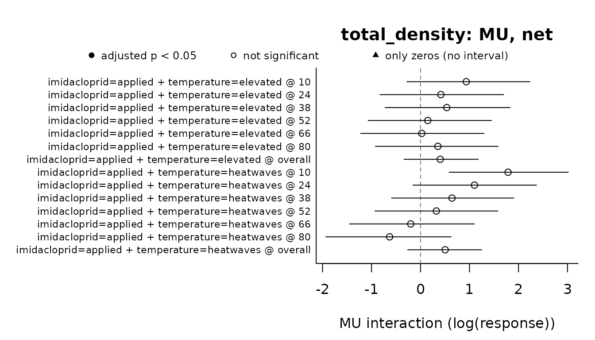

# Two mesocosm experiments

This article applies the whole workflow of must, from the design to the
methods paragraph, to two outdoor mesocosm experiments whose data come
with the package: Polazzo & Rico (2021), with an insecticide, a
herbicide and nutrient enrichment, and Hermann et al. (2024), with an
insecticide and three temperature regimes.
[`vignette("must")`](https://pabloamadorc.github.io/must/articles/must.md)
explains each step; here the emphasis is on the choices that each data
set asks for and on how to read the results. The analyses illustrate the
package and do not replace those of the original articles.

Each analysis follows the same steps:

1.  [`describe_design()`](https://pabloamadorc.github.io/must/reference/describe_design.md):
    what the design identifies, with the samplings taken before the
    stressors were applied declared in `baseline`.
2.  [`fit_responses()`](https://pabloamadorc.github.io/must/reference/fit_responses.md):
    one model per response, with its error distribution chosen for the
    data.
3.  [`suggest_null_models()`](https://pabloamadorc.github.io/must/reference/suggest_null_models.md):
    the null models that the guidelines of Schäfer & Piggott (2018) give
    for what is known about the stressors and for the effects of each
    stressor alone, estimated from the model.
4.  [`estimate_interactions()`](https://pabloamadorc.github.io/must/reference/estimate_interactions.md),
    [`classify_interactions()`](https://pabloamadorc.github.io/must/reference/classify_interactions.md)
    and
    [`compare_null_models()`](https://pabloamadorc.github.io/must/reference/compare_null_models.md):
    the interactions, their classes and whether the null models agree on
    them.
5.  [`report_interactions()`](https://pabloamadorc.github.io/must/reference/report_interactions.md):
    the methods and the table of decisions.

What
[`suggest_null_models()`](https://pabloamadorc.github.io/must/reference/suggest_null_models.md)
needs to know about the stressors is the same in both experiments. The
stressors do not act similarly, and one of them acts specifically on
physiology: chlorpyrifos (an inhibitor of acetylcholinesterase) and
diuron (an inhibitor of photosystem II) in the first experiment,
imidacloprid (which binds to the nicotinic acetylcholine receptors of
insects) in the second. The responses are densities, counts and a loss
of mass, not mortality, and with a single concentration of each
pesticide the stressor-effect relationships are not known. How the
sensitivities to the stressors are distributed and correlated is not
known either: those criteria are left unknown, so that every value is
tried.

``` r

library(must)
suggest <- function(fit) {
  suggest_null_models(fit, similar_action = FALSE, specific_action = TRUE,
                      mortality = FALSE, stressor_effect = FALSE)
}
```

The residual checks of
[`fit_responses()`](https://pabloamadorc.github.io/must/reference/fit_responses.md)
are switched off (`residual_checks = FALSE`) only so that this article
runs without the DHARMa package; in an analysis, keep the default.

## Insecticide, herbicide and nutrients

Polazzo & Rico (2021) used 24 outdoor mesocosms, three per combination
of a full factorial of chlorpyrifos (1 µg/L, or absent), diuron (18
µg/L, or absent) and nutrients (nitrogen and phosphorus added twice a
week, or ambient). The nutrient additions started four weeks before the
pesticides were applied, on day 0.

``` r

stressors <- c("insecticide", "herbicide", "nutrients")
control <- c(insecticide = "absent", herbicide = "absent", nutrients = "ambient")
```

### Phytoplankton

`polazzo_phytoplankton` has the density of each taxon and their total on
days -5, 7, 15 and 50. Day -5 precedes the pesticides but not the
nutrients, so it is a baseline for the pesticides only. Declared per
stressor in `baseline`, it stays in the model, and no interaction that
involves a pesticide is tested on it.

``` r

phyto_design <- describe_design(polazzo_phytoplankton, stressors, control,
                                unit = "mesocosm", time = "day",
                                baseline = list(insecticide = -5, herbicide = -5))
phyto_design$sets[, c("set_id", "stressors", "net_identifiable", "pure_identifiable")]
#>   set_id                           stressors net_identifiable pure_identifiable
#> 1    S01               herbicide x nutrients             TRUE                NA
#> 2    S02             insecticide x nutrients             TRUE                NA
#> 3    S03             insecticide x herbicide             TRUE                NA
#> 4    S04 insecticide x herbicide x nutrients             TRUE              TRUE
```

The full factorial identifies the three pairwise interactions and the
three-way one, whose pure interaction can be separated from the pairwise
ones. The densities are whole numbers, which
[`fit_responses()`](https://pabloamadorc.github.io/must/reference/fit_responses.md)
would take for counts; as densities, counts scaled to a volume (the
source does not give the unit), they are declared continuous in
`response_types`.

``` r

phyto_fit <- fit_responses(polazzo_phytoplankton, "total_density", phyto_design,
                           response_types = c(total_density = "continuous"),
                           residual_checks = FALSE, seed = 1, quiet = TRUE)
phyto_fit
#> <must_fit> 1 response(s); time structure: interaction; dispersion: common; random effects: (1 | .unit)
#> Residual checks: not run; seed: 1
#>   total_density: gamma_log (log link; continuous, declared), AIC 1740.6, n = 96, missing = 0, residual checks: not run; random effects: none
phyto_fit$fits$total_density$reason
#> [1] "The random intercept(s) for '.unit' had variance estimated at zero and were removed from the selected model (same maximum likelihood)."
```

A Gamma model with a log link fits best. The variance of its random
intercept per mesocosm was estimated at zero, and the intercept was
removed.

``` r

phyto_choice <- suggest(phyto_fit)
phyto_choice$null_models
#> [1] "AD" "MU" "DO"
table(phyto_choice$sets$type, phyto_choice$sets$time)
#>                   
#>                    15 50 7
#>   all neutral       0  1 1
#>   double neutral    1  3 3
#>   positive neutral  3  0 0
```

The guidelines leave the three null models of Madge Pimentel et
al. (2025): simple addition (AD), the multiplicative model (MU) and
dominance (DO). The stress addition model needs mortality as the effect,
concentration addition stressors that act similarly, and dominance stays
because the correlation of the sensitivities is unknown. In most sets
and days the single effects are too uncertain to have a direction (types
of Piggott et al. 2015); on day 15 the insecticide alone increased the
phytoplankton.

``` r

phyto_est <- estimate_interactions(phyto_fit, null_models = phyto_choice, n_sim = 4000,
                                   seed = 2021)
e <- phyto_est$estimates
# Effects of each stressor alone, as multiples of the control density
single <- e[e$order == 3L & e$component == "single" & e$null_model == "MU",
            c("time", "stressor", "estimate", "lower", "upper", "p_adjusted")]
single[c("estimate", "lower", "upper")] <- round(exp(single[c("estimate", "lower", "upper")]), 1)
single$p_adjusted <- signif(single$p_adjusted, 2)
single
#>        time    stressor estimate lower upper p_adjusted
#> 115       7 insecticide      7.0   1.1  48.7     0.0620
#> 116       7   herbicide      3.0   0.4  19.8     0.2400
#> 117       7   nutrients      7.0   0.9  50.4     0.1800
#> 128      15 insecticide      8.0   1.2  56.3     0.0620
#> 129      15   herbicide      3.0   0.5  21.0     0.2400
#> 130      15   nutrients      3.8   0.5  25.5     0.2400
#> 141      50 insecticide      3.8   0.5  27.7     0.1700
#> 142      50   herbicide      4.7   0.6  32.6     0.2400
#> 143      50   nutrients      0.8   0.1   5.3     0.7800
#> 154 overall insecticide      6.0   2.0  18.2     0.0025
#> 155 overall   herbicide      3.5   1.1  10.7     0.0280
#> 156 overall   nutrients      2.8   0.9   8.3     0.0800
summary(phyto_est)
#> Interactions: Krinsky-Robb simulation; small-sample correction; adjusted p-values (BH) below 0.05
#> Deviating / tested interactions by sampling time:
#>       response model estimand   7  15  50 overall
#>  total_density    AD      net 0/4 0/4 0/4     1/4
#>  total_density    MU      net 0/4 0/4 0/4     1/4
#>  total_density    DO      net 0/3 0/3 0/3     2/3
#>  total_density    AD     pure 1/1 0/1 1/1     1/1
#>  total_density    MU     pure 1/1 1/1 1/1     1/1
#> 
#> Classes of the net deviations (Piggott et al. 2015) by sampling time:
#>       response model    7   15   50    overall
#>  total_density    AD 4 AD 4 AD 4 AD 3 AD, 1 -S
#>  total_density    MU 4 AD 4 AD 4 AD 3 AD, 1 -S
#> 
#> Agreement between null models (AD, MU, DO), robust/model-dependent/conflicting/none:
#>       response estimand       7      15      50 overall
#>  total_density      net 0/0/0/4 0/0/0/4 0/0/0/4 1/1/0/2
#>  total_density     pure 1/0/0/0 0/1/0/0 1/0/0/0 1/0/0/0
#> 
#> Counts of boundary tests and of rows not estimated: `$interactions`; classes: `$classes`.
```

On single days none of these effects is significant once the p-values
are adjusted across sets and days, but averaged over the samplings the
insecticide alone multiplied the phytoplankton by 6 and the herbicide
alone by 3.5. Few interactions deviate from the null models, mostly in
the averages over time:

``` r

phyto_agreement <- compare_null_models(phyto_est)
phyto_agreement[phyto_agreement$agreement %in% c("robust", "model_dependent", "conflicting"),
                c("time", "stressors", "estimand", "AD", "MU", "DO", "agreement")]
#>       time                           stressors estimand AD MU   DO
#> 4  overall               herbicide x nutrients      net  -  -    -
#> 12 overall             insecticide x herbicide      net  0  0    -
#> 14       7 insecticide x herbicide x nutrients     pure  +  + <NA>
#> 16      15 insecticide x herbicide x nutrients     pure  0  + <NA>
#> 18      50 insecticide x herbicide x nutrients     pure  +  + <NA>
#> 20 overall insecticide x herbicide x nutrients     pure  +  + <NA>
#>          agreement
#> 4           robust
#> 12 model_dependent
#> 14          robust
#> 16 model_dependent
#> 18          robust
#> 20          robust
phyto_classes <- classify_interactions(phyto_est)
phyto_classes[phyto_classes$time == "overall" & phyto_classes$null_model != "DO",
              c("stressors", "null_model", "single_codes", "code_interaction", "class")]
#>                              stressors null_model
#> 10               herbicide x nutrients         AD
#> 11               herbicide x nutrients         MU
#> 22             insecticide x nutrients         AD
#> 23             insecticide x nutrients         MU
#> 34             insecticide x herbicide         AD
#> 35             insecticide x herbicide         MU
#> 46 insecticide x herbicide x nutrients         AD
#> 47 insecticide x herbicide x nutrients         MU
#>                               single_codes code_interaction class
#> 10                herbicide +; nutrients 0               --    -S
#> 11                herbicide +; nutrients 0               --    -S
#> 22              insecticide +; nutrients 0                0    AD
#> 23              insecticide +; nutrients 0                0    AD
#> 34              insecticide +; herbicide +                0    AD
#> 35              insecticide +; herbicide +                0    AD
#> 46 insecticide +; herbicide +; nutrients 0                0    AD
#> 47 insecticide +; herbicide +; nutrients 0                0    AD
```

The mean densities explain them:

``` r

after <- polazzo_phytoplankton[polazzo_phytoplankton$day > 0, ]
treatment <- paste(after$insecticide, after$herbicide, after$nutrients, sep = " / ")
phyto_means <- round(tapply(after$total_density, list(treatment, after$day), mean))
phyto_means
#>                                     7    15   50
#> absent / absent / added          3308  2127 1302
#> absent / absent / ambient         471   555 1679
#> absent / diuron / added           501   115  549
#> absent / diuron / ambient        1413  1642 7855
#> chlorpyrifos / absent / added    2283  4405 1329
#> chlorpyrifos / absent / ambient  3297  4438 6365
#> chlorpyrifos / diuron / added   63345 25668 1655
#> chlorpyrifos / diuron / ambient  3224  9617  608
```

- **Herbicide and nutrients.** Diuron alone increased the phytoplankton,
  nutrients alone did not change it on average, and together they kept
  it at or below the density of the controls. Averaged over the
  samplings, every null model flags this deviation (`robust`), and the
  classes call it a negative synergism (−S) under AD and MU.
- **The two pesticides.** Only dominance flags their interaction
  (`model_dependent`): whether it deviates depends on the mechanism
  assumed, and the guidelines leave that open because the correlation of
  the sensitivities is unknown.
- **The three stressors.** Their net deviation is not significant, but
  the pure three-way interaction is positive under AD and MU: with the
  three stressors together the phytoplankton bloomed (on day 7, 19 times
  the density with nutrients alone) beyond what the pairwise
  interactions explain.

### Macroinvertebrates

`polazzo_macroinvertebrates` counts the individuals of each taxon on
days -32, 15, 30 and 50. Day -32 precedes every stressor, so it is a
common baseline. Besides the total, the analysis follows *Cloeon*, a
mayfly, an insect group sensitive to organophosphate insecticides such
as chlorpyrifos.

``` r

macro_design <- describe_design(polazzo_macroinvertebrates, stressors, control,
                                unit = "mesocosm", time = "day", baseline = -32)
macro_fit <- fit_responses(polazzo_macroinvertebrates, c("total_abundance", "cloeon"),
                           macro_design, residual_checks = FALSE, seed = 1, quiet = TRUE)
macro_fit
#> <must_fit> 2 response(s); time structure: interaction; dispersion: common; random effects: (1 | .unit)
#> Residual checks: not run; seed: 1
#>   total_abundance: nbinom2 (log link; count, detected), AIC 1200.4, n = 95, missing = 1, residual checks: not run
#>   cloeon: nbinom2 (log link; count, detected), AIC 769.2, n = 96, missing = 0, residual checks: not run; random effects: none
```

Both are counts, and the negative binomial fits both; the total of one
sample is missing in the source and that sample is left out. The
guidelines leave the same three null models:

``` r

macro_choice <- suggest(macro_fit)
macro_choice$null_models
#> [1] "AD" "MU" "DO"
macro_est <- estimate_interactions(macro_fit, null_models = macro_choice, n_sim = 4000,
                                   seed = 2021)
summary(macro_est)
#> Interactions: Krinsky-Robb simulation; small-sample correction; adjusted p-values (BH) below 0.05
#> Deviating / tested interactions by sampling time:
#>         response model estimand  15  30  50 overall
#>  total_abundance    AD      net 0/4 0/4 0/4     0/4
#>  total_abundance    MU      net 0/4 0/4 0/4     0/4
#>  total_abundance    DO      net 0/3 0/3 0/3     0/3
#>  total_abundance    AD     pure 0/1 0/1 0/1     0/1
#>  total_abundance    MU     pure 0/1 0/1 0/1     0/1
#>           cloeon    AD      net 0/1 0/4 0/4     0/1
#>           cloeon    MU      net 0/1 0/4 0/4     0/1
#>           cloeon    DO      net 0/1 0/3 0/3     0/1
#>           cloeon    AD     pure 0/0 0/1 0/1     0/0
#>           cloeon    MU     pure 0/0 0/1 0/1     0/0
#> 
#> Classes of the net deviations (Piggott et al. 2015) by sampling time:
#>         response model   15   30   50 overall
#>  total_abundance    AD 4 AD 4 AD 4 AD    4 AD
#>  total_abundance    MU 4 AD 4 AD 4 AD    4 AD
#>           cloeon    AD 1 AD 4 AD 4 AD    1 AD
#>           cloeon    MU 1 AD 4 AD 4 AD    1 AD
#> 
#> Agreement between null models (AD, MU, DO), robust/model-dependent/conflicting/none:
#>         response estimand      15      30      50 overall
#>  total_abundance      net 0/0/0/4 0/0/0/4 0/0/0/4 0/0/0/4
#>  total_abundance     pure 0/0/0/1 0/0/0/1 0/0/0/1 0/0/0/1
#>           cloeon      net 0/0/0/1 0/0/0/4 0/0/0/4 0/0/0/1
#>           cloeon     pure 0/0/0/0 0/0/0/1 0/0/0/1 0/0/0/0
#> 
#> Counts of boundary tests and of rows not estimated: `$interactions`; classes: `$classes`.
```

The total, 39% of which are the snail *Physella acuta*, shows no effect
and no interaction. *Cloeon* tells another story:

``` r

day15 <- polazzo_macroinvertebrates[polazzo_macroinvertebrates$day == 15, ]
with(day15, tapply(cloeon, list(insecticide, paste(herbicide, nutrients, sep = " / ")),
                   paste, collapse = ", "))
#>              absent / added absent / ambient diuron / added diuron / ambient
#> absent       "54, 97, 50"   "4, 68, 35"      "21, 84, 101"  "27, 24, 37"    
#> chlorpyrifos "0, 0, 0"      "0, 0, 0"        "0, 0, 1"      "0, 0, 0"
e <- macro_est$estimates
e[e$response == "cloeon" & e$order == 3L & e$component == "single" & e$null_model == "AD",
  c("time", "stressor", "estimate", "p_adjusted", "status")]
#>        time    stressor   estimate   p_adjusted        status
#> 269      15 insecticide -35.666667 6.416802e-05      boundary
#> 270      15   herbicide  -6.333333 7.710000e-01            ok
#> 271      15   nutrients  31.333333 4.995000e-01            ok
#> 282      30 insecticide -51.666667 2.317500e-01            ok
#> 283      30   herbicide -47.000000 6.255000e-01            ok
#> 284      30   nutrients -54.000000 3.075000e-01            ok
#> 295      50 insecticide  -2.000000 8.875000e-01            ok
#> 296      50   herbicide  -7.000000 7.710000e-01            ok
#> 297      50   nutrients  12.000000 4.995000e-01            ok
#> 308 overall insecticide         NA           NA not_estimable
#> 309 overall   herbicide -20.111111 2.080000e-01            ok
#> 310 overall   nutrients  -3.555556 8.435000e-01            ok
with(e[e$response == "cloeon" & e$component == "interaction", ], table(status, time))
#>                time
#> status          15 30 50 overall
#>   not_defined    1  1  1       1
#>   not_estimable 10  0  0      10
#>   ok             3 13 13       3
```

Two weeks after the application, chlorpyrifos had eliminated *Cloeon*
from every mesocosm but one. The effect of the insecticide alone is then
tested from the probability of observing only zeros if *Cloeon* had kept
the density of the controls (`status = "boundary"`; adjusted p \<
0.001). The interactions that need the mesocosms with the insecticide
alone cannot be measured on that day (`not_estimable`): once a stressor
alone has eliminated the response, nothing is left on which the other
stressors could add or multiply. From day 30 the effect of the
insecticide is no longer detected, and no interaction is detected
either. A community total can hide the loss of its most sensitive taxa.

## Insecticide and heat

Hermann et al. (2024) used 24 outdoor mesocosms, four per combination of
a 2 x 3 factorial: imidacloprid (nominal 1 µg/L, applied on days 0, 14
and 28, or absent) and temperature (ambient; elevated, 4 °C above
ambient; or three heatwaves of 7 days, separated by 7 days at ambient
temperature). The temperature treatments lasted until day 42, and the
following six weeks were a recovery phase. The water temperature
measured in the evening shows the heatwaves, on days 3, 17 and 31:

``` r

evening <- hermann_water_quality[hermann_water_quality$time_of_day == "evening", ]
round(tapply(evening$water_temperature, list(evening$temperature, evening$day), mean), 1)
#>           -4    3   10   17   24   31   38   52   66   80
#> ambient   17 17.0 19.9 17.4 23.1 22.4 24.1 22.6 26.0 25.2
#> elevated  17 21.1 24.5 21.6 27.6 26.6 28.2 22.7 26.0 25.1
#> heatwaves 17 24.2 20.5 27.9 23.8 32.0 24.8 22.7 25.9 25.0
```

Temperature has three levels, so the design gives two contrast sets:
imidacloprid with elevated temperature and imidacloprid with heatwaves,
each against ambient temperature.

``` r

h_stressors <- c("imidacloprid", "temperature")
h_control <- c(imidacloprid = "absent", temperature = "ambient")
```

### Zooplankton

`hermann_zooplankton` has the density of each taxon and their total,
sampled the day before the first application (day -1, a baseline for
both stressors) and every two weeks after it, a few days after each
heatwave during the heat phase.

``` r

zoo_design <- describe_design(hermann_zooplankton, h_stressors, h_control,
                              unit = "mesocosm", time = "day", baseline = -1)
zoo_design$sets[, c("set_id", "stressors", "levels")]
#>   set_id                  stressors
#> 1    S01 imidacloprid x temperature
#> 2    S02 imidacloprid x temperature
#>                                         levels
#> 1  imidacloprid=applied | temperature=elevated
#> 2 imidacloprid=applied | temperature=heatwaves
zoo_fit <- fit_responses(hermann_zooplankton, "total_density", zoo_design,
                         residual_checks = FALSE, seed = 1, quiet = TRUE)
zoo_fit
#> <must_fit> 1 response(s); time structure: interaction; dispersion: common; random effects: (1 | .unit)
#> Residual checks: not run; seed: 1
#>   total_density: gamma_log (log link; continuous, detected), AIC 2287.3, n = 168, missing = 0, residual checks: not run
zoo_choice <- suggest(zoo_fit)
zoo_choice$null_models
#> [1] "AD" "MU" "DO"
```

A non-significant interaction is not evidence of additivity. To ask
whether the combination follows a null model, a margin is declared, here
generously: deviations smaller than half the density of the reference
combination are taken as negligible (`margin = 0.5`; see “Additive, or
only not detected?” in
[`vignette("must")`](https://pabloamadorc.github.io/must/articles/must.md)).

``` r

zoo_est <- estimate_interactions(zoo_fit, null_models = zoo_choice, n_sim = 4000,
                                 seed = 2024, margin = 0.5)
e <- zoo_est$estimates
# Effects of warming alone, as multiples of the density at ambient temperature
warming <- e[e$component == "single" & e$stressor %in% "temperature" &
               e$null_model == "MU" & e$time != "overall",
             c("time", "levels", "estimate", "lower", "upper", "p_adjusted")]
warming$levels <- sub(".*temperature=", "", warming$levels)
warming[c("estimate", "lower", "upper")] <- round(exp(warming[c("estimate", "lower", "upper")]), 2)
warming$p_adjusted <- signif(warming$p_adjusted, 2)
warming
#>     time    levels estimate lower upper p_adjusted
#> 6     10  elevated     0.32  0.13  0.78      0.058
#> 15    24  elevated     0.40  0.17  0.98      0.110
#> 24    38  elevated     0.91  0.38  2.19      1.000
#> 33    52  elevated     1.78  0.70  4.33      0.340
#> 42    66  elevated     0.98  0.41  2.39      1.000
#> 51    80  elevated     0.89  0.38  2.15      1.000
#> 69    10 heatwaves     0.30  0.12  0.74      0.058
#> 78    24 heatwaves     0.30  0.12  0.75      0.058
#> 87    38 heatwaves     0.35  0.14  0.86      0.064
#> 96    52 heatwaves     1.02  0.42  2.56      1.000
#> 105   66 heatwaves     0.99  0.41  2.36      1.000
#> 114   80 heatwaves     1.80  0.75  4.62      0.340
```

The heatwaves reduced the zooplankton to about a third of its density at
ambient temperature on the three samplings of the heat phase, and
elevated temperature on the first two; after the heat phase the
densities recovered. The intervals of those effects exclude no change,
but their adjusted p-values are just above 0.05: intervals are not
adjusted for the twelve sets and times, p-values are.

``` r

summary(zoo_est)
#> Interactions: Krinsky-Robb simulation; small-sample correction; adjusted p-values (BH) below 0.05
#> Deviating / tested interactions by sampling time:
#>       response model estimand  10  24  38  52  66  80 overall
#>  total_density    AD      net 0/2 0/2 0/2 0/2 0/2 0/2     0/2
#>  total_density    MU      net 0/2 0/2 0/2 0/2 0/2 0/2     0/2
#>  total_density    DO      net 0/2 0/2 0/2 0/2 0/2 0/2     0/2
#> 
#> Classes of the net deviations (Piggott et al. 2015) by sampling time:
#>       response model   10   24   38   52   66   80 overall
#>  total_density    AD 2 AD 2 AD 2 AD 2 AD 2 AD 2 AD    2 AD
#>  total_density    MU 2 AD 2 AD 2 AD 2 AD 2 AD 2 AD    2 AD
#> 
#> Verdicts with an equivalence margin of +/-0.5 of the reference cell, deviation/negligible/equivalent/inconclusive:
#>       response model estimand      10      24      38      52      66      80
#>  total_density    AD      net 0/0/0/2 0/0/0/2 0/0/0/2 0/0/0/2 0/0/0/2 0/0/0/2
#>  total_density    MU      net 0/0/0/2 0/0/0/2 0/0/0/2 0/0/0/2 0/0/0/2 0/0/0/2
#>  total_density    DO      net 0/0/0/2 0/0/0/2 0/0/0/2 0/0/0/2 0/0/0/2 0/0/0/2
#>  overall
#>  0/0/0/2
#>  0/0/0/2
#>  0/0/0/2
#> 
#> Agreement between null models (AD, MU, DO), robust/model-dependent/conflicting/none:
#>       response estimand      10      24      38      52      66      80 overall
#>  total_density      net 0/0/0/2 0/0/0/2 0/0/0/2 0/0/0/2 0/0/0/2 0/0/0/2 0/0/0/2
#> 
#> Counts of boundary tests and of rows not estimated: `$interactions`; classes: `$classes`.
plot(zoo_est, null_model = "MU")
```



``` r

rel <- e[e$component == "interaction" & e$null_model == "MU" & e$time != "overall",
         c("time", "levels", "relative", "relative_lower", "relative_upper")]
rel$levels <- sub(".*temperature=", "", rel$levels)
rel[3:5] <- lapply(rel[3:5], round, 2)
rel
#>     time    levels relative relative_lower relative_upper
#> 8     10  elevated     0.27          -0.16           0.77
#> 17    24  elevated     0.15          -0.61           0.55
#> 26    38  elevated     0.39          -1.06           1.26
#> 35    52  elevated     0.25          -3.96           1.97
#> 44    66  elevated     0.03          -3.04           1.10
#> 53    80  elevated     0.29          -1.69           1.18
#> 71    10 heatwaves     0.81           0.26           2.04
#> 80    24 heatwaves     0.42          -0.10           1.07
#> 89    38 heatwaves     0.20          -0.35           0.60
#> 98    52 heatwaves     0.34          -2.17           1.49
#> 107   66 heatwaves    -0.20          -3.53           0.80
#> 116   80 heatwaves    -0.64          -5.22           0.37
```

No interaction deviates from any null model after the adjustment, and
none is equivalent either: every verdict is inconclusive. The relative
deviations under MU, (observed − expected) / reference, have intervals
far wider than ±0.5. With four mesocosms per combination and densities
this variable, the experiment cannot tell additivity from interactions
as large as the effects of the stressors themselves.

### Chironomids

The larvae of the chironomids recorded in `hermann_macroinvertebrates`
(Chironomini, Orthocladiinae and Tanypodinae) are added into one count.
Macroinvertebrates were sampled a week before the first application (day
-7) and every two weeks after it.

``` r

macro_h <- hermann_macroinvertebrates
macro_h$chironomidae <- macro_h$chironomini + macro_h$orthocladiinae + macro_h$tanypodinae
chiro_design <- describe_design(macro_h, h_stressors, h_control, unit = "mesocosm",
                                time = "day", baseline = -7)
chiro_fit <- fit_responses(macro_h, "chironomidae", chiro_design, residual_checks = FALSE,
                           seed = 1, quiet = TRUE)
chiro_fit
#> <must_fit> 1 response(s); time structure: interaction; dispersion: common; random effects: (1 | .unit)
#> Residual checks: not run; seed: 1
#>   chironomidae: nbinom2 (log link; count, detected), AIC 1229.2, n = 168, missing = 0, residual checks: not run
chiro_est <- estimate_interactions(chiro_fit, null_models = suggest(chiro_fit),
                                   n_sim = 4000, seed = 2024)
summary(chiro_est)
#> Interactions: Krinsky-Robb simulation; small-sample correction; adjusted p-values (BH) below 0.05
#> Deviating / tested interactions by sampling time:
#>      response model estimand   7  21  35  49  63  77 overall
#>  chironomidae    AD      net 0/2 0/2 0/2 0/2 0/2 0/2     0/2
#>  chironomidae    MU      net 0/2 0/2 0/2 0/2 0/2 0/2     0/2
#>  chironomidae    DO      net 0/2 0/2 0/2 0/2 0/2 0/2     0/2
#> 
#> Classes of the net deviations (Piggott et al. 2015) by sampling time:
#>      response model    7   21   35   49   63   77 overall
#>  chironomidae    AD 2 AD 2 AD 2 AD 2 AD 2 AD 2 AD    2 AD
#>  chironomidae    MU 2 AD 2 AD 2 AD 2 AD 2 AD 2 AD    2 AD
#> 
#> Agreement between null models (AD, MU, DO), robust/model-dependent/conflicting/none:
#>      response estimand       7      21      35      49      63      77 overall
#>  chironomidae      net 0/0/0/2 0/0/0/2 0/0/0/2 0/0/0/2 0/0/0/2 0/0/0/2 0/0/0/2
#> 
#> Counts of boundary tests and of rows not estimated: `$interactions`; classes: `$classes`.
before <- macro_h[macro_h$day == -7, ]
round(tapply(before$chironomidae, list(before$imidacloprid, before$temperature), mean), 1)
#>         ambient elevated heatwaves
#> absent     22.0      7.2       4.2
#> applied     7.8      9.5       2.8
```

Neither stressor alone has a detectable effect on the larvae, and no
interaction is detected. Before the treatments, the mesocosms assigned
to the control already held about three times as many larvae as most of
the others: with four mesocosms per combination, chance differences
among groups of mesocosms are as large as many treatment effects.

### Leaf litter decomposition

Leaf litter in coarse-mesh bags, open to macroinvertebrates, lost mass
by microbial decomposition and by macroinvertebrate feeding.
`mass_loss_percent` is the share of the initial 2 g that each bag lost;
one bag gained mass, and its percentage is missing in the source.

``` r

litter <- hermann_leaf_litter[hermann_leaf_litter$process == "macroinvertebrate feeding", ]
litter_design <- describe_design(litter, h_stressors, h_control, unit = "mesocosm",
                                 time = "day")
litter_fit <- fit_responses(litter, "mass_loss_percent", litter_design,
                            residual_checks = FALSE, seed = 1, quiet = TRUE)
litter_fit
#> <must_fit> 1 response(s); time structure: interaction; dispersion: common; random effects: (1 | .unit)
#> Residual checks: not run; seed: 1
#>   mass_loss_percent: lognormal (log link; continuous, detected), AIC 765.3, n = 119, missing = 1, residual checks: not run
litter_choice <- suggest(litter_fit)
litter_choice$models[, c("null_model", "status")]
#>   null_model   status
#> 1         AD possible
#> 2         MU excluded
#> 3         DO possible
#> 4        SAM excluded
#> 5         CA excluded
writeLines(strwrap(litter_choice$models$reason[litter_choice$models$null_model == "MU"], 80))
#> The multiplicative model needs mortality as the effect (step 5) or the sum of
#> the effects above the effect limit (step 6), but the effect is not mortality
#> and the sum of the effects does not exceed the effect limit.
```

Here the guidelines exclude the multiplicative model. The effects of the
stressors alone are far from the effect limit (no decomposition at all),
their sum never exceeds it, and the effect is not mortality: neither
step 5 nor step 6 of the guidelines, which lead to MU, is reached. The
null models suggested depend on the effects estimated for each response,
not only on what is known about the stressors.

``` r

litter_est <- estimate_interactions(litter_fit, null_models = litter_choice, n_sim = 4000,
                                    seed = 2024)
summary(litter_est)
#> Interactions: Krinsky-Robb simulation; small-sample correction; adjusted p-values (BH) below 0.05
#> Deviating / tested interactions by sampling time:
#>           response model estimand  11  25  39  53  81 overall
#>  mass_loss_percent    AD      net 0/2 0/2 0/2 0/2 0/2     0/2
#>  mass_loss_percent    DO      net 0/2 0/2 0/2 0/2 0/2     0/2
#> 
#> Classes of the net deviations (Piggott et al. 2015) by sampling time:
#>           response model   11   25   39   53   81 overall
#>  mass_loss_percent    AD 2 AD 2 AD 2 AD 2 AD 2 AD    2 AD
#> 
#> Agreement between null models (AD, DO), robust/model-dependent/conflicting/none:
#>           response estimand      11      25      39      53      81 overall
#>  mass_loss_percent      net 0/0/0/2 0/0/0/2 0/0/0/2 0/0/0/2 0/0/0/2 0/0/0/2
#> 
#> Counts of boundary tests and of rows not estimated: `$interactions`; classes: `$classes`.
e <- litter_est$estimates
# Effects of warming alone on the mass lost, in percentage points
warming <- e[e$component == "single" & e$null_model == "AD" &
               e$stressor %in% "temperature" & e$time != "overall",
             c("time", "levels", "estimate", "lower", "upper", "p_adjusted")]
warming$levels <- sub(".*temperature=", "", warming$levels)
warming[c("estimate", "lower", "upper")] <- round(warming[c("estimate", "lower", "upper")], 1)
warming$p_adjusted <- signif(warming$p_adjusted, 2)
warming
#>    time    levels estimate lower upper p_adjusted
#> 2    11  elevated     -0.1  -6.1   5.9     0.9700
#> 7    25  elevated      4.5  -0.9  11.2     0.1800
#> 12   39  elevated      7.9   0.6  15.6     0.0990
#> 17   53  elevated     -1.1  -9.4   7.7     0.9700
#> 22   81  elevated      0.7  -6.8   8.4     0.9700
#> 32   11 heatwaves      5.0  -1.3  11.9     0.1800
#> 37   25 heatwaves     18.5  12.1  25.3     0.0025
#> 42   39 heatwaves     14.4   6.4  22.4     0.0050
#> 47   53 heatwaves     -0.5  -8.8   7.8     0.9700
#> 52   81 heatwaves     11.8   3.3  20.6     0.0220
```

The heatwaves increased the loss of mass by 12 to 18 percentage points
on the collections of days 25, 39 and 81, and no interaction with
imidacloprid is detected.

## Methods and decisions

[`report_interactions()`](https://pabloamadorc.github.io/must/reference/report_interactions.md)
writes the methods of each analysis from its objects. For the
zooplankton of Hermann et al. (2024), with its classes and the agreement
among null models:

``` r

zoo_report <- report_interactions(zoo_est, classes = classify_interactions(zoo_est),
                                  agreement = compare_null_models(zoo_est))
cat(zoo_report$methods, sep = "\n\n")
#> The experiment combined 2 stressors, imidacloprid (absent and applied, with absent as control) and temperature (ambient, elevated and heatwaves, with ambient as control), in a full factorial design (6 treatment combinations), with 4 experimental units (mesocosm) per combination, sampled at 7 times (day -1, 10, 24, 38, 52, 66 and 80). The sampling before the stressors were applied (day -1) was not tested. The design identified 2 contrast sets: 2 pairwise interactions.
#> 
#> The analysis was run with the R package must 0.2.0 (Amador Crespo 2026) in R 4.6.2 (R Core Team 2026). The response (total_density) was modelled with a generalized linear mixed model with one mean per treatment combination and sampling time (a cell-means model) and a random intercept for each mesocosm, fitted by maximum likelihood with glmmTMB 1.1.15.2 (Brooks et al. 2017). The error distribution was chosen among candidates suited to the values of the response (Gaussian (identity link), Gaussian (log link), Gamma (log link) and lognormal (log link)): the candidate that converged with a positive-definite Hessian and had the lowest AIC was selected. The model selected was Gamma (log link). For the inference, the selected model was refitted by restricted maximum likelihood (REML).
#> 
#> Each interaction was tested against simple addition (AD), the multiplicative model (MU) and dominance (DO). The null models were chosen with the guidelines of Schäfer & Piggott (2018), in which must adds two conditions: concentration addition requires that the stressors alone act in the same direction, and stress addition that none of them increases the response. The authors stated that the stressors do not act similarly, one of them acts specifically on physiology, the effect is not mortality and the stressor-effect relationships are not known. They did not state whether the distribution of sensitivities is known or how the sensitivities are correlated. The criteria that depend on the effects of the stressors alone (whether one effect reaches 90% of the effect limit, whether their sum exceeds the limit, whether a stressor alone increases the response and whether two act in opposite directions) were evaluated from the effects estimated by the models in each contrast set and sampling time, with 95% intervals; a criterion was not known when the interval spanned its threshold. Each criterion that was not known (or that differed among contrast sets) took each of its values, and every null model reached was kept.
#> 
#> Following Madge Pimentel et al. (2025), each interaction was computed from the means predicted by the model with the random effects at zero (post-estimation inference), as the deviation of the combination of stressors from the expectation of the null model, as a difference on the scale of the response (AD and DO) and as a difference on the log scale (MU). Uncertainty was obtained from 4,000 draws of the fixed effects from their estimated distribution (Krinsky & Robb 1986), which gave percentile intervals and two-sided p-values. To correct for small samples, the covariance came from the REML refit and the distributions were t, with the degrees of freedom given by the replication of the experimental units (18). Intervals were computed at the 95% level, and p-values were adjusted for the false discovery rate (Benjamini & Hochberg 1995) within each response, null model and estimate, across contrast sets and sampling times; effects averaged over the sampling times were tested and adjusted separately. Each interaction was also tested for equivalence with two one-sided tests (Schuirmann 1987) of whether its deviation relative to the response of the reference combination, (observed - expected) / reference, lay between -0.5 and 0.5; each test measured the signed distance of the means from the closest means at the bound, on a scale that stabilizes their variance (Anscombe 1948). Random numbers were generated with seed 2024.
#> 
#> Interactions were classified with the directional scheme of Piggott et al. (2015): each single, combined and interaction effect was coded as positive, negative or not significant from its adjusted p-value (alpha = 0.05), and each net interaction was classed as additive (no deviation detected), as a positive or negative synergism or as a positive or negative antagonism (their Table 1). Dominance, which does not predict the combination from the single effects, was not classified. With the equivalence margin, each net interaction was also a deviation, a negligible deviation (detected but within the margin), equivalent (no deviation detected and within the margin) or inconclusive. Across the null models compared (AD, MU and DO), an interaction was robust when every null model tested flagged a deviation with the same sign (adjusted p < 0.05), dependent on the null model when only some did, and conflicting when they flagged deviations of opposite sign.
zoo_report$decisions[!zoo_report$decisions$source %in% c("default", "recorded"),
                     c("decision", "value", "source")]
#>                                                                  decision
#> 1                                      Stressors and their control levels
#> 2                                                       Experimental unit
#> 3                                                           Sampling time
#> 4                             Samplings before the stressors were applied
#> 14                                            Residual checks with DHARMa
#> 15                                  Distribution selected (total_density)
#> 16                      The stressors act similarly (same mode of action)
#> 17                           One stressor acts specifically on physiology
#> 18                                                The effect is mortality
#> 19                              The stressor-effect relationship is known
#> 25 The effect of one stressor is close to the effect limit (at least 90%)
#> 26                  The sum of the effects compared with the effect limit
#> 27                                A stressor alone increases the response
#> 28                                  Stressors alone with opposite effects
#> 29                                                            Null models
#> 31                                             Number of simulation draws
#> 37                                                     Equivalence margin
#> 38                                                Seed of the simulations
#>                                                                 value
#> 1        imidacloprid (control absent), temperature (control ambient)
#> 2                                                            mesocosm
#> 3                                                                 day
#> 4                                                                  -1
#> 14                                                              FALSE
#> 15                                                   Gamma (log link)
#> 16                                                                 no
#> 17                                                                yes
#> 18                                                                 no
#> 19                                                                 no
#> 25                                                                 no
#> 26 varies (uncertain in 10, below in 2 of 12 contrast sets and times)
#> 27                                                                 no
#> 28                                                                 no
#> 29                                                         AD, MU, DO
#> 31                                                               4000
#> 37                                                                0.5
#> 38                                                               2024
#>                   source
#> 1                    set
#> 2                    set
#> 3                    set
#> 4                    set
#> 14                   set
#> 15                chosen
#> 16                   set
#> 17                   set
#> 18                   set
#> 19                   set
#> 25             estimated
#> 26             estimated
#> 27             estimated
#> 28             estimated
#> 29 suggest_null_models()
#> 31                   set
#> 37                   set
#> 38                   set
```

## What the two experiments show

- **Few interactions survive.** With three or four mesocosms per
  combination, several contrast sets and several samplings, few
  interactions remain significant once the p-values are adjusted.
  Averages over the samplings (`time = "overall"`) are more powerful, as
  for the herbicide and nutrients on the phytoplankton.
- **Not detected is not additive.** The tests of equivalence on the
  zooplankton of Hermann et al. (2024) were all inconclusive, even with
  a margin of half the reference density.
- **The null model decides some interactions.** The interaction of the
  two pesticides on the phytoplankton deviates only from dominance: only
  a mechanistic hypothesis about the correlation of the sensitivities
  can say whether it is an interaction.
- **The suggestion depends on the data.** Within the same experiment,
  the guidelines left AD, MU and DO for the zooplankton and only AD and
  DO for leaf litter decomposition, because the effects of the stressors
  alone differ between the responses.
- **Totals can hide sensitive taxa.** The total of the
  macroinvertebrates did not change while chlorpyrifos eliminated the
  mayfly *Cloeon*, whose interactions could not be measured on that day.

## References

Hermann, M., Polazzo, F., Cherta, L., Crettaz-Minaglia, M.,
García-Astillero, A., Peeters, E. T. H. M., Rico, A., & Van den Brink,
P. J. (2024). Combined stress of an insecticide and heatwaves or
elevated temperature induce community and food web effects in a
Mediterranean freshwater ecosystem. *Water Research*, 260, 121903.
<https://doi.org/10.1016/j.watres.2024.121903>. Data:
<https://doi.org/10.5281/zenodo.11520459> (CC BY 4.0).

Madge Pimentel, I., Albini, D., Beermann, A. J., Leese, F., Macaulay, S.
J., Matthaei, C. D., Orr, J. A., Piggott, J. J., & Schäfer, R. B.
(2025). Hypothesis-driven research on multiple stressors: An analytical
framework for stressor interactions. *Ecology and Evolution*, 15,
e71959. <https://doi.org/10.1002/ece3.71959>

Piggott, J. J., Townsend, C. R., & Matthaei, C. D. (2015).
Reconceptualizing synergism and antagonism among multiple stressors.
*Ecology and Evolution*, 5(7), 1538–1547.
<https://doi.org/10.1002/ece3.1465>

Polazzo, F., & Rico, A. (2021). Effects of multiple stressors on the
dimensionality of ecological stability. *Ecology Letters*, 24(8),
1594–1606. <https://doi.org/10.1111/ele.13770>. Data:
<https://doi.org/10.5061/dryad.qfttdz0gt> (CC0 1.0).

Schäfer, R. B., & Piggott, J. J. (2018). Advancing understanding and
prediction in multiple stressor research through a mechanistic basis for
null models. *Global Change Biology*, 24(5), 1817–1826.
<https://doi.org/10.1111/gcb.14073>
