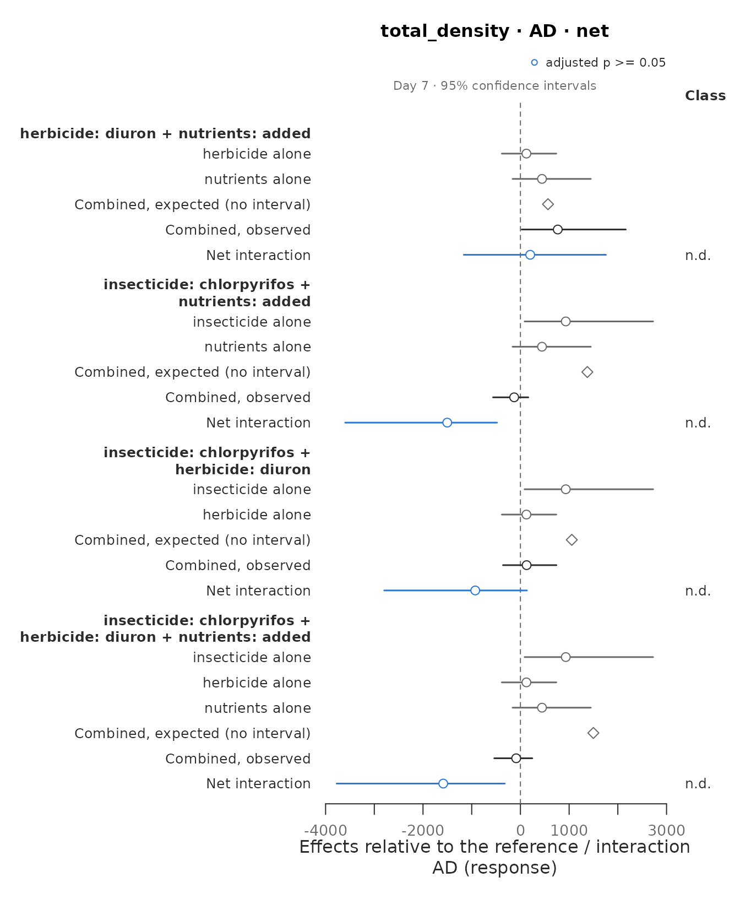
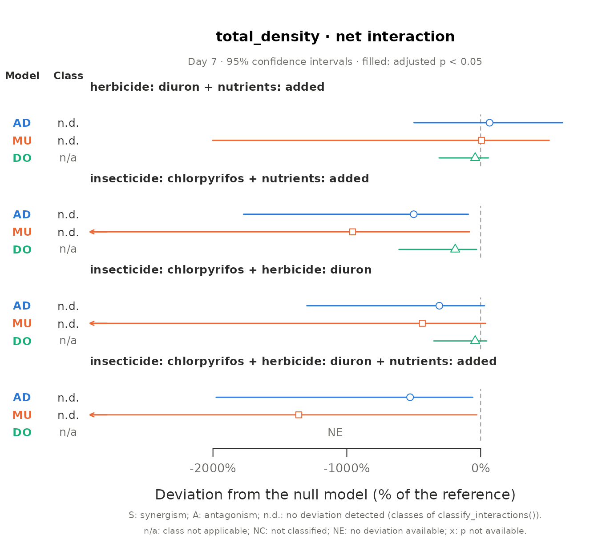

# Multiple-stressor interactions with must

``` r

library(must)
has_emmeans <- requireNamespace("emmeans", quietly = TRUE)
```

Calling a combined effect additive, synergistic or antagonistic is a
statement about a null model, not about the data alone. must separates
the three decisions behind such a statement and makes each one visible
in the output:

1.  **What the design can identify**
    ([`describe_design()`](https://pabloamadorc.github.io/must/reference/describe_design.md)):
    which treatment combinations exist, which interactions they
    identify, which cells are shared, how the experimental units were
    replicated and sampled, and whether some stressor was applied to
    whole groups of units.
2.  **Which model fits the data**
    ([`fit_responses()`](https://pabloamadorc.github.io/must/reference/fit_responses.md)):
    a generalised linear mixed model per response, with its error
    distribution chosen for the data and not for the null model.
3.  **What “non-additive” means**
    ([`estimate_interactions()`](https://pabloamadorc.github.io/must/reference/estimate_interactions.md)):
    each combination of stressors is tested against one or more null
    models, each on its own scale, with the same criteria and from the
    predictions of the same model (Madge Pimentel et al. 2025), with a
    correction for experiments with few replicates. Simple addition (AD)
    is the default (see “The default null model”); multiplication (MU)
    and dominance (DO), the other null models of Madge Pimentel et
    al. (2025), Bliss independence (BL), with the emergent three-way
    interaction of Beppler et al. (2016), the stress addition model
    (SAM) of Liess et al. (2016) and concentration addition (CA, Loewe
    additivity) are chosen in `null_models`, by name or with
    [`suggest_null_models()`](https://pabloamadorc.github.io/must/reference/suggest_null_models.md),
    which applies the guidelines of Schäfer & Piggott (2018) to what is
    known about the stressors. The same tests apply to a model fitted
    with another package (see “Models fitted outside must”).

[`report_interactions()`](https://pabloamadorc.github.io/must/reference/report_interactions.md)
then writes the methods of the analysis and the table of every decision
behind it, from the settings of the objects.

## A worked example: insecticide, herbicide and nutrients

`polazzo_zooplankton` comes from an outdoor mesocosm experiment with a
full factorial of chlorpyrifos, diuron and nutrient enrichment, three
mesocosms per combination (Polazzo & Rico 2021). Zooplankton were
sampled five days before the pesticide application and on days 7, 14, 30
and 50 after it. Because nutrient additions started four weeks before
the pesticides, day -5 is not a pre-treatment baseline for all
stressors; the example uses the four samplings after the application.
Besides the design, the table has the total density and one column per
taxon; the first eight columns are the design and the three responses
analysed below.

``` r

zoo <- polazzo_zooplankton[polazzo_zooplankton$day > 0, ]
head(zoo[, 1:8])
#>    mesocosm day  insecticide herbicide nutrients total_density daphnia
#> 25      M01   7 chlorpyrifos    absent     added      59.55818     1.2
#> 26      M02   7       absent    absent     added     594.79936    44.2
#> 27      M03   7       absent    diuron   ambient     678.32075     0.2
#> 28      M04   7 chlorpyrifos    diuron     added     170.78957     0.0
#> 29      M05   7 chlorpyrifos    absent   ambient    1686.68181     0.0
#> 30      M06   7       absent    diuron     added     730.98377     0.6
#>    simocephalus
#> 25          1.0
#> 26          7.0
#> 27          4.6
#> 28          0.6
#> 29          1.6
#> 30          0.4
```

### 1. The design

``` r

design <- describe_design(
  zoo,
  stressors = c("insecticide", "herbicide", "nutrients"),
  control = c(insecticide = "absent", herbicide = "absent", nutrients = "ambient"),
  unit = "mesocosm",
  time = "day"
)
design
#> <must_design> 96 rows, 3 stressors, 8 observed treatment combinations
#> Stressors (control): insecticide (absent), herbicide (absent), nutrients (ambient)
#> Unit: mesocosm | Time: day | By: none | Groups: none
#> Contrast sets: 4 candidate(s), 4 identifiable
#> Checks:
#>   info     Experimental unit: 'mesocosm' (24 units, each in a single
#>            treatment combination).
#>   info     Units per treatment combination: 3.
#>   info     Units are measured repeatedly (4 sampling times; 4 per unit).
#>            Samplings of the same unit are not independent: by default
#>            fit_responses() adds a random intercept per unit, which assumes
#>            the same correlation between any two samplings of a unit;
#>            temporal autocorrelation can be modelled through its `random`
#>            argument.
#>   info     Identifiable contrast sets (net deviation): 3 with 2 stressors;
#>            1 with 3 stressors.
#>   info     4 identifiable set(s) share cells (one cell is used by up to 4
#>            sets, typically the control): their estimates are correlated,
#>            not independent replicates of an interaction.
design$sets[, c("set_id", "stressors", "net_identifiable", "pure_identifiable", "shared")]
#>   set_id                           stressors net_identifiable pure_identifiable
#> 1    S01               herbicide x nutrients             TRUE                NA
#> 2    S02             insecticide x nutrients             TRUE                NA
#> 3    S03             insecticide x herbicide             TRUE                NA
#> 4    S04 insecticide x herbicide x nutrients             TRUE              TRUE
#>   shared
#> 1   TRUE
#> 2   TRUE
#> 3   TRUE
#> 4   TRUE
```

The full factorial identifies the three pairwise interactions and both
the net deviation and the pure interaction of the three stressors. All
four sets share the control, and the mesocosms are measured repeatedly.

### 2. One model per response

Each response gets the candidates that suit its values (here positive
densities, with zeros for *Daphnia*); the one selected is the one with
the lowest AIC among those that converge and, by default, pass the
DHARMa residual checks. The checks are switched off here only because
the vignette must build without DHARMa.

``` r

fits <- fit_responses(zoo, c("total_density", "cyclopoida", "daphnia"), design,
                      residual_checks = FALSE, seed = 1, quiet = TRUE)
fits
#> <must_fit> 3 response(s); time structure: interaction; dispersion: common; random effects: (1 | .unit)
#> Residual checks: not run; seed: 1
#>   total_density: gamma_log (log link; continuous, detected), AIC 1311.9, n = 96, missing = 0, residual checks: not run
#>   cyclopoida: tweedie (log link; continuous, detected), AIC 927.8, n = 96, missing = 0, residual checks: not run
#>   daphnia: tweedie (log link; continuous, detected), AIC 410.0, n = 96, missing = 0, residual checks: not run
fits$fits$total_density$selection[, c("family", "link", "converged", "aic", "selected")]
#>         family     link converged      aic selected
#> 1     gaussian identity      TRUE 1370.024    FALSE
#> 2 gaussian_log      log      TRUE 1346.364    FALSE
#> 3    gamma_log      log      TRUE 1311.942     TRUE
#> 4    lognormal      log      TRUE 1320.196    FALSE
fits$fits$daphnia$reason
#> [1] "Some treatment combinations have only zeros ('herbicide=diuron at 14', 'herbicide=diuron at 30', 'herbicide=diuron at 50' and 3 more): their means are fixed at the boundary of the link function, and contrasts that use them are tested from the probability of that outcome."
```

*Daphnia* was absent from every mesocosm of some treatment combinations
on some days. With a log link their means lie on the boundary of the
parameter space, where intervals from the model are not valid, so they
are fixed there. When such a combination is the one a contrast compares
with its reference (the herbicide alone against the control, say), the
contrast is tested from the probability of observing only zeros if the
null model held (`status = "boundary"`); when it is a cell the null
model needs to compute its expectation, the contrast is `not_estimable`.

### 3. Which null models?

[`suggest_null_models()`](https://pabloamadorc.github.io/must/reference/suggest_null_models.md)
applies the guidelines of Schäfer & Piggott (2018, Fig. 3) to what is
known about the stressors. Chlorpyrifos inhibits an enzyme of the
nervous system, diuron the photosynthesis of algae, and the nutrients
add resources: the three stressors do not act similarly, and the
insecticide acts specifically on physiology. The effect is a change in
density, not mortality, and with one level of each stressor the
experiment gives no stressor-effect relationship. How the sensitivities
of the taxa to the stressors are correlated is not known, nor is the
distribution of their sensitivities, so both are left unknown (`NA`, the
default). The effects of each stressor alone, as shares of the effect
limit (here the loss of the whole density), are estimated from the
models in every contrast set and on every day, without using the
combinations of stressors.

``` r

choice <- suggest_null_models(fits, similar_action = FALSE, specific_action = TRUE,
                              mortality = FALSE, stressor_effect = FALSE)
choice
#> <must_null_models> after the guidelines of Schäfer and Piggott (2018), Fig. 3
#> Criteria:
#>   The stressors act similarly (same mode of action)                       no
#>   One stressor acts specifically on physiology                            yes
#>   The effect is mortality                                                 no
#>   The stressor-effect relationship is known                               no
#>   The sensitivity distribution is known                                   unknown
#>   Correlation of the sensitivities                                        unknown
#>   The effect of one stressor is close to the effect limit (at least 90%)  varies (estimated): no in 20, uncertain in 28 of 48 contrast sets and times
#>   The sum of the effects compared with the effect limit                   varies (estimated): below in 12, uncertain in 36 of 48 contrast sets and times
#>   A stressor alone increases the response                                 varies (estimated): no in 28, yes in 12, uncertain in 8 of 48 contrast sets and times
#>   Stressors alone with opposite effects                                   varies (estimated): no in 42, uncertain in 6 of 48 contrast sets and times
#> Effects of the stressors alone: estimated in 48 of 48 contrast sets and
#>   times of 3 responses, with 95% intervals.
#>   In 13 of them the point estimates put one effect close to the limit
#>   or at about ten times the others: the null models predict similar
#>   joint effects there.
#>   Directions of the effects (types of Piggott et al. 2015): double
#>   neutral in 22, unknown in 13, positive neutral in 7, all neutral in
#>   6.
#>   Where a stressor alone increases the response, the increase offsets
#>   the decreases in the sum of the effects, and concentration addition
#>   and the stress addition model are not reached.
#> Null models:
#>   AD (simple addition): possible in 48 of 48. Step 4: the sensitivities
#>     are highly negatively correlated and the sum of the effects is
#>     below the effect limit; step 7: none of the earlier steps applies.
#>   MU (multiplicative): possible in 36 of 48. Step 6: the sum of the
#>     effects exceeds the effect limit. The effect addition of
#>     ecotoxicology: "BL" (Bliss independence) gives the same prediction,
#>     with the deviation relative to the reference cell.
#>   DO (dominance): possible in 48 of 48. Step 3: the sensitivities are
#>     highly positively correlated, or the effect of one stressor is
#>     close to the effect limit. Allowed by the design: some sets.
#>     Dominance is defined for two stressors only: sets of three or more
#>     stressors are not estimated.
#>   SAM (stress addition): excluded. The stress addition model needs one
#>     stressor that acts specifically on physiology, mortality as the
#>     effect, stressors that do not increase the response and a known
#>     stressor-effect relationship or sensitivity distribution (step 2),
#>     but the effect is not mortality.
#>   CA (concentration addition): excluded. Concentration addition needs
#>     stressors that act similarly, with effects in the same direction,
#>     and a known stressor-effect relationship (step 1), but the
#>     stressors do not act similarly and their stressor-effect
#>     relationship is not known.
#> Unknown criteria that would change the choice:
#>   Correlation of the sensitivities (`correlation`): positive -> DO;
#>     negative -> AD, MU, DO; weak -> AD, MU, DO
#> For estimate_interactions(): null_models = c("AD", "MU", "DO")
table(choice$sets$response, choice$sets$type, useNA = "ifany")
#>                
#>                 all neutral double neutral positive neutral <NA>
#>   cyclopoida              3             10                3    0
#>   daphnia                 0              2                1   13
#>   total_density           3             10                3    0
```

The unknown correlation of the sensitivities keeps dominance (if it were
highly positive) besides simple addition and the multiplicative model,
and in most sets and days the effects are too uncertain to tell whether
their sum exceeds the effect limit, which would call for the
multiplicative model.

Stressors need not reduce a response. With three mesocosms per treatment
most single effects cannot be told from zero (`"double neutral"`), but
the insecticide increases the total density on day 7 and the cyclopoid
copepods on day 50, and the nutrients increase *Daphnia* on days 14 and
30 (`"positive neutral"`, the types of Piggott et al. 2015); the cells
of *Daphnia* with only zeros give no interval, so their direction is not
known (`NA`). The guidelines take such effects with their sign: an
increase offsets the decreases in the sum of the effects, which exceeds
the effect limit when simple addition would predict a density below
zero, and it rules out concentration addition and the stress addition
model, which assume effects in one direction and stressors that reduce
the response. For a proportion such as survival that the stressors alone
increase, the guidelines are applied to its complement, and
[`estimate_interactions()`](https://pabloamadorc.github.io/must/reference/estimate_interactions.md)
then needs the `sensitivity` that the suggestion gives. The guidelines
were written for individuals and populations; for a community total,
Schäfer & Piggott (2018) point to the compositional null model of
Thompson et al. (2018), which predicts it from the null models of each
taxon. `choice$sets` gives the null models reached in each set and day.

### 4. Null models

The guidelines leave the three null models of Madge Pimentel et
al. (2025).
[`estimate_interactions()`](https://pabloamadorc.github.io/must/reference/estimate_interactions.md)
takes them from `choice` and keeps its criteria and reasons in
`settings$null_model_choice`:

``` r

est <- estimate_interactions(fits, null_models = choice, n_sim = 4000, seed = 2021)
e <- est$estimates
triple <- e[e$response == "total_density" & e$order == 3L & e$component == "interaction" &
              e$null_model != "DO",
            c("time", "null_model", "estimand", "estimate", "lower", "upper", "df",
              "p_value", "p_adjusted", "status")]
triple
#>        time null_model estimand      estimate        lower        upper df
#> 140       7         AD      net -1584.3928039 -3773.332977 -319.8926961 16
#> 141       7         AD     pure   644.7171382 -1123.100163 2799.5527597 16
#> 146       7         MU      net    -3.0019073    -5.416250   -0.5298598 16
#> 147       7         MU     pure     1.2552274    -1.210669    3.5921941 16
#> 153      14         AD      net  -291.2212972 -1395.583516  810.1136139 16
#> 154      14         AD     pure  -672.0256073 -2643.776631  687.1611355 16
#> 159      14         MU      net    -0.9067135    -3.305019    1.5636066 16
#> 160      14         MU     pure    -0.2166525    -2.526591    2.1748717 16
#> 166      30         AD      net   231.4838641  -638.940101 1261.0871765 16
#> 167      30         AD     pure    24.6511477 -1083.843032 1110.7695513 16
#> 172      30         MU      net     0.9718122    -1.472525    3.2916701 16
#> 173      30         MU     pure     0.3535512    -2.019895    2.7604308 16
#> 179      50         AD      net     8.4339010 -1063.035703 1204.6764574 16
#> 180      50         AD     pure   353.4447110  -593.429209 1492.4134020 16
#> 185      50         MU      net     0.3694890    -2.003136    2.8015817 16
#> 186      50         MU     pure     0.8069171    -1.634400    3.1436660 16
#> 192 overall         AD      net  -408.9240840 -1468.128198  495.5234629 16
#> 193 overall         AD     pure    87.6968474 -1027.714254 1176.7080566 16
#> 198 overall         MU      net    -0.6418299    -2.640329    1.3249497 16
#> 199 overall         MU     pure     0.5497608    -1.434721    2.4811811 16
#>     p_value p_adjusted status
#> 140  0.0230  0.1840000     ok
#> 141  0.4135  0.5600000     ok
#> 146  0.0210  0.1680000     ok
#> 147  0.2950  0.8245000     ok
#> 153  0.4875  0.8770909     ok
#> 154  0.2780  0.5600000     ok
#> 159  0.4500  0.7403636     ok
#> 160  0.8245  0.8245000     ok
#> 166  0.5660  0.8770909     ok
#> 167  0.9625  0.9625000     ok
#> 172  0.3890  0.7403636     ok
#> 173  0.7605  0.8245000     ok
#> 179  0.9740  0.9935000     ok
#> 180  0.4200  0.5600000     ok
#> 185  0.7585  0.8668571     ok
#> 186  0.5025  0.8245000     ok
#> 192  0.3020  0.3825000     ok
#> 193  0.8480  0.8480000     ok
#> 198  0.5130  0.5130000     ok
#> 199  0.5805  0.5805000     ok
```

On day 7 the net deviation of the three stressors is negative under AD
and MU, while the pure three-way interaction is not: the deviation is
carried by the pairwise interactions, which the full factorial lets us
estimate. After the adjustment for the many sets and times tested,
neither is significant with 24 mesocosms. The rows with
`time = "overall"` average each effect over the four samplings.

``` r

pairs7 <- e[e$response == "total_density" & e$time == "7" & e$order == 2L &
              e$component == "interaction" & e$null_model != "DO",
            c("stressors", "null_model", "estimate", "lower", "upper", "p_adjusted")]
pairs7
#>                  stressors null_model      estimate        lower        upper
#> 4    herbicide x nutrients         AD  2.007259e+02 -1163.000647 1755.7992896
#> 8    herbicide x nutrients         MU  1.796003e-02    -1.738837    1.7303797
#> 49 insecticide x nutrients         AD -1.502493e+03 -3597.879520 -479.7616286
#> 53 insecticide x nutrients         MU -2.873597e+00    -4.616498   -1.0803669
#> 94 insecticide x herbicide         AD -9.273429e+02 -2796.992011  133.6516840
#> 98 insecticide x herbicide         MU -1.401498e+00    -3.128813    0.3860525
#>    p_adjusted
#> 4   0.8916923
#> 8   0.9820000
#> 49  0.0960000
#> 53  0.0720000
#> 94  0.4640000
#> 98  0.5893333
summary(est)
#> Interactions: Krinsky-Robb simulation; small-sample correction; adjusted p-values (BH) below 0.05
#> Deviating / tested interactions by sampling time:
#>       response model estimand   7  14  30  50 overall
#>  total_density    AD      net 0/4 0/4 0/4 0/4     0/4
#>  total_density    MU      net 0/4 0/4 0/4 0/4     0/4
#>  total_density    DO      net 0/3 0/3 0/3 0/3     0/3
#>  total_density    AD     pure 0/1 0/1 0/1 0/1     0/1
#>  total_density    MU     pure 0/1 0/1 0/1 0/1     0/1
#>     cyclopoida    AD      net 0/4 0/4 0/4 0/4     0/4
#>     cyclopoida    MU      net 0/4 0/4 0/4 0/4     0/4
#>     cyclopoida    DO      net 0/3 0/3 0/3 0/3     0/3
#>     cyclopoida    AD     pure 0/1 0/1 0/1 0/1     0/1
#>     cyclopoida    MU     pure 0/1 0/1 0/1 0/1     0/1
#>        daphnia    AD      net 0/1 0/0 0/1 0/1     0/0
#>        daphnia    MU      net 0/1 0/0 0/1 0/1     0/0
#>        daphnia    DO      net 0/1 0/0 0/1 0/1     0/0
#>        daphnia    AD     pure 0/0 0/0 0/0 0/0     0/0
#>        daphnia    MU     pure 0/0 0/0 0/0 0/0     0/0
#> 
#> Classes of the net deviations (Piggott et al. 2015) by sampling time:
#>       response model    7   14   30   50 overall
#>  total_density    AD 4 AD 4 AD 4 AD 4 AD    4 AD
#>  total_density    MU 4 AD 4 AD 4 AD 4 AD    4 AD
#>     cyclopoida    AD 4 AD 4 AD 4 AD 4 AD    4 AD
#>     cyclopoida    MU 4 AD 4 AD 4 AD 4 AD    4 AD
#>        daphnia    AD 1 AD      1 AD 1 AD        
#>        daphnia    MU 1 AD      1 AD 1 AD        
#> 
#> Agreement between null models (AD, MU, DO), robust/model-dependent/conflicting/none:
#>       response estimand       7      14      30      50 overall
#>  total_density      net 0/0/0/4 0/0/0/4 0/0/0/4 0/0/0/4 0/0/0/4
#>  total_density     pure 0/0/0/1 0/0/0/1 0/0/0/1 0/0/0/1 0/0/0/1
#>     cyclopoida      net 0/0/0/4 0/0/0/4 0/0/0/4 0/0/0/4 0/0/0/4
#>     cyclopoida     pure 0/0/0/1 0/0/0/1 0/0/0/1 0/0/0/1 0/0/0/1
#>        daphnia      net 0/0/0/1 0/0/0/0 0/0/0/1 0/0/0/1 0/0/0/0
#>        daphnia     pure 0/0/0/0 0/0/0/0 0/0/0/0 0/0/0/0 0/0/0/0
#> 
#> Counts of boundary tests and of rows not estimated: `$interactions`; classes: `$classes`.
```

### 5. Classes

``` r

cls <- classify_interactions(est)
table(cls$class, cls$order, useNA = "ifany")
#>       
#>         2  3
#>   AD   66 20
#>   <NA> 69 25
cls[cls$response == "total_density" & cls$time == "7" & cls$null_model == "AD",
    c("stressors", "pattern", "class", "borderline")]
#>                              stressors
#> 1                herbicide x nutrients
#> 16             insecticide x nutrients
#> 31             insecticide x herbicide
#> 46 insecticide x herbicide x nutrients
#>                                            pattern class borderline
#> 1                                  a 0 | b 0 | i 0    AD      FALSE
#> 16                                 a 0 | b 0 | i 0    AD       TRUE
#> 31                                 a 0 | b 0 | i 0    AD      FALSE
#> 46 insecticide 0 | herbicide 0 | nutrients 0 | i 0    AD      FALSE
```

With the correction for small samples and the adjustment for multiple
tests, no interaction of this experiment deviates clearly from the null
models. [`plot()`](https://rdrr.io/r/graphics/plot.default.html) shows
how each interaction arises: the effect of each stressor alone, the
combined effect expected under the null model (the observed combined
effect minus the net interaction), the combined effect observed and the
interaction, with its class at the right. On day 7, under AD, the first
null model:

``` r

plot(est, response = "total_density", time = "7")
```



Filled points have an adjusted p-value below 0.05. The intervals are not
adjusted for the number of sets and times, so an interval can exclude
zero while its adjusted p-value stays above 0.05, as for the insecticide
and nutrients here. `type = "models"` draws the same interactions under
each null model, as deviations relative to the reference cell, a
quantity the null models share, with the class under each:

``` r

plot(est, response = "total_density", type = "models", time = "7")
```



`type = "interactions"` draws the interactions alone, one row each,
which suits many sets and times (`group_by` writes what they share as
headers), and `type = "time"` follows each set over the sampling times.

### 6. Methods and decisions

[`report_interactions()`](https://pabloamadorc.github.io/must/reference/report_interactions.md)
writes the statistical methods of this analysis from the settings of
`est` and, if given, of the classes and of the comparison of null
models: the design, the model selected for each response and how, the
null models and the criteria behind them, and how the interactions were
estimated and tested, with the works cited. Every value comes from the
objects, so the text matches the analysis that was run; the description
of the experiment itself (organisms, exposure, measurements) is left to
the authors.

``` r

report <- report_interactions(est, classes = cls)
cat(report$methods, sep = "\n\n")
#> The experiment combined 3 stressors, insecticide (absent and chlorpyrifos, with absent as control), herbicide (absent and diuron, with absent as control) and nutrients (ambient and added, with ambient as control), in a full factorial design (8 treatment combinations), with 3 experimental units (mesocosm) per combination, sampled at 4 times (day 7, 14, 30 and 50). The design identified 4 contrast sets: 3 pairwise interactions and 1 three-way interaction, with the stressors outside each set at their control.
#> 
#> The analysis was run with the R package must 0.3.0 (Amador Crespo & Rico 2026) in R 4.6.2 (R Core Team 2026). Each response (total_density, cyclopoida and daphnia) was modelled with a generalized linear mixed model with one mean per treatment combination and sampling time (a cell-means model) and a random intercept for each mesocosm, fitted by maximum likelihood with glmmTMB 1.1.15.2 (Brooks et al. 2017). The error distribution was chosen among candidates suited to the values of each response (Gaussian (identity link), Gaussian (log link), Gamma (log link) and lognormal (log link), for total_density; Gaussian (identity link), Gaussian (log link) and Tweedie (log link), for cyclopoida and daphnia): the candidate that converged with a positive-definite Hessian and had the lowest AIC was selected. The models selected were Gamma (log link) for total_density; Tweedie (log link) for cyclopoida and daphnia. The means of the treatment combinations with only zeros (6 for daphnia) were fixed at the boundary of the link function; a contrast that compares such a combination with its expectation was tested from the probability of observing only zeros under that expectation, and contrasts that need such a combination to compute it were not estimated. For the inference, the selected models were refitted by restricted maximum likelihood (REML).
#> 
#> Each interaction was tested against simple addition (AD), the multiplicative model (MU) and dominance (DO). The null models were chosen with the guidelines of Schäfer & Piggott (2018), in which must adds two conditions: concentration addition requires that the stressors alone act in the same direction, and stress addition that none of them increases the response. The authors stated that the stressors do not act similarly, one of them acts specifically on physiology, the effect is not mortality and the stressor-effect relationships are not known. They did not state whether the distribution of sensitivities is known or how the sensitivities are correlated. The criteria that depend on the effects of the stressors alone (whether one effect reaches 90% of the effect limit, whether their sum exceeds the limit, whether a stressor alone increases the response and whether two act in opposite directions) were evaluated from the effects estimated by the models in each contrast set and sampling time, with 95% intervals; a criterion was not known when the interval spanned its threshold. Each criterion that was not known (or that differed among contrast sets) took each of its values, and every null model reached was kept.
#> 
#> Following Madge Pimentel et al. (2025), each interaction was computed from the means predicted by the models with the random effects at zero (post-estimation inference), as the deviation of the combination of stressors from the expectation of the null model, as a difference on the scale of the response (AD and DO) and as a difference on the log scale (MU). For sets of three or more stressors, both the net deviation from the single effects and the pure highest-order interaction (under AD and MU) were estimated. Dominance is defined for two stressors only. Uncertainty was obtained from 4,000 draws of the fixed effects from their estimated distribution (Krinsky & Robb 1986), which gave percentile intervals and two-sided p-values. To correct for small samples, the covariance came from the REML refit and the distributions were t, with the degrees of freedom given by the replication of the experimental units (16). Intervals were computed at the 95% level, and p-values were adjusted for the false discovery rate (Benjamini & Hochberg 1995) within each response, null model and estimate, across contrast sets and sampling times; effects averaged over the sampling times were tested and adjusted separately. Random numbers were generated with seed 2021.
#> 
#> Interactions were classified with the directional scheme of Piggott et al. (2015): each single, combined and interaction effect was coded as positive, negative or not significant from its adjusted p-value (alpha = 0.05), and each net interaction was classed as additive (no deviation detected), as a positive or negative synergism or as a positive or negative antagonism (their Table 1). Dominance, which does not predict the combination from the single effects, was not classified. For three or more stressors, the same rules were applied to the net deviation and the single effects of all the stressors of the set; pure interactions were not classified.
```

The table of decisions gives, for every argument, the value used, its
default and its source: the default, set by the user, chosen by must
(the distribution selected, a seed drawn at random), estimated (criteria
of the guidelines evaluated from the effects), taken from
[`suggest_null_models()`](https://pabloamadorc.github.io/must/reference/suggest_null_models.md)
or recorded (versions). The decisions that differ from the defaults are
those a reviewer will look for first:

``` r

changed <- !report$decisions$source %in% c("default", "recorded")
report$decisions[changed, c("decision", "value", "source")]
#>                                                                  decision
#> 1                                      Stressors and their control levels
#> 2                                                       Experimental unit
#> 3                                                           Sampling time
#> 15                                            Residual checks with DHARMa
#> 16                                  Distribution selected (total_density)
#> 17                                     Distribution selected (cyclopoida)
#> 18                                        Distribution selected (daphnia)
#> 19                      The stressors act similarly (same mode of action)
#> 20                           One stressor acts specifically on physiology
#> 21                                                The effect is mortality
#> 22                              The stressor-effect relationship is known
#> 28 The effect of one stressor is close to the effect limit (at least 90%)
#> 29                  The sum of the effects compared with the effect limit
#> 30                                A stressor alone increases the response
#> 31                                  Stressors alone with opposite effects
#> 32                                                            Null models
#> 34                                             Number of simulation draws
#> 41                                                Seed of the simulations
#>                                                                                    value
#> 1  insecticide (control absent), herbicide (control absent), nutrients (control ambient)
#> 2                                                                               mesocosm
#> 3                                                                                    day
#> 15                                                                                 FALSE
#> 16                                                                      Gamma (log link)
#> 17                                                                    Tweedie (log link)
#> 18                                                                    Tweedie (log link)
#> 19                                                                                    no
#> 20                                                                                   yes
#> 21                                                                                    no
#> 22                                                                                    no
#> 28                      varies (no in 20, uncertain in 28 of 48 contrast sets and times)
#> 29                   varies (below in 12, uncertain in 36 of 48 contrast sets and times)
#> 30            varies (no in 28, yes in 12, uncertain in 8 of 48 contrast sets and times)
#> 31                       varies (no in 42, uncertain in 6 of 48 contrast sets and times)
#> 32                                                                            AD, MU, DO
#> 34                                                                                  4000
#> 41                                                                                  2021
#>                   source
#> 1                    set
#> 2                    set
#> 3                    set
#> 15                   set
#> 16                chosen
#> 17                chosen
#> 18                chosen
#> 19                   set
#> 20                   set
#> 21                   set
#> 22                   set
#> 28             estimated
#> 29             estimated
#> 30             estimated
#> 31             estimated
#> 32 suggest_null_models()
#> 34                   set
#> 41                   set
```

`print(report)` shows the paragraphs, the table and the references as
plain text. In an R Markdown or Quarto document, a chunk with
`results = "asis"` and
`cat(format(report, format = "markdown"), sep = "\n")` inserts them as
paragraphs, a table and a list of references. A justification of the
null models can be added with `justification`.

## Additive, or only not detected?

A non-significant interaction is a failure to detect a deviation: with
few replicates most interactions are classed “AD” whatever their true
size. To claim that a combination follows a null model, declare before
the analysis the largest deviation that would be negligible, as a share
of the response of the reference cell, in `margin`. Each interaction is
then also tested for equivalence, with two one-sided tests (Schuirmann
1987; Lakens et al. 2018), on its relative deviation, (observed −
expected) / reference, which is on the same scale for every null model.
Each test measures how many standard errors separate the estimated means
from the closest means at which the deviation equals the margin, on a
scale on which the variance of a mean does not depend on the mean (the
square root for counts, for example), so it does not depend on
`inference`.

In ten tanks per combination where copepods follow the multiplicative
model exactly:

``` r

tanks <- expand.grid(salinity = c("ambient", "high"), warming = c("no", "yes"),
                     replicate = 1:10, stringsAsFactors = FALSE)
tanks$tank <- seq_len(nrow(tanks))
mu <- 100 * ifelse(tanks$salinity == "high", 0.7, 1) * ifelse(tanks$warming == "yes", 0.8, 1)
tanks$copepods <- qpois((tanks$replicate - 0.5) / 10, mu)
tank_design <- describe_design(tanks, c("salinity", "warming"),
  control = c(salinity = "ambient", warming = "no"), unit = "tank")
tank_fit <- fit_responses(tanks, "copepods", tank_design, residual_checks = FALSE,
                          seed = 1, quiet = TRUE)
eq <- estimate_interactions(tank_fit, null_models = c("AD", "MU"), n_sim = 4000, seed = 1,
                            margin = 0.1)
eq$estimates[eq$estimates$component == "interaction",
             c("null_model", "relative", "relative_lower", "relative_upper", "p_adjusted",
               "p_equivalence_adjusted")]
#>   null_model     relative relative_lower relative_upper p_adjusted
#> 4         AD 0.0609390609    -0.05411084     0.16638163      0.276
#> 8         MU 0.0007594803    -0.08749538     0.07863754      0.986
#>   p_equivalence_adjusted
#> 4              0.2351589
#> 8              0.0144178
classify_interactions(eq)[, c("null_model", "class", "verdict")]
#>   null_model class      verdict
#> 1         AD    AD inconclusive
#> 2         MU    AD   equivalent
```

Both null models give the class AD, but only the multiplicative one is
equivalent within ±10% of the control. Under simple addition no
deviation is detected, but it could be larger than the margin: the
verdict is inconclusive. A deviation detected but within the margin
would be `"negligible"`. With three mesocosms per combination, no
interaction of the zooplankton experiment is equivalent even within ±25%
of the control: they are inconclusive, not additive.

``` r

eq_zoo <- estimate_interactions(fits, null_models = c("AD", "MU"), n_sim = 4000, seed = 2021,
                                margin = 0.25)
table(classify_interactions(eq_zoo)$verdict, useNA = "ifany")
#> 
#> inconclusive         <NA> 
#>           86           34
```

The margin has no default: which deviation is negligible depends on the
response and on the question, and has to be fixed before the results are
seen. Equivalence also needs replication: in simulated 2 x 2 experiments
with four units per combination, a margin of ±10% was never reached. The
test kept its nominal error for Gaussian responses, survival and
overdispersed counts analysed with a quasi-Poisson
[`glm()`](https://rdrr.io/r/stats/glm.html) or with the negative
binomial of
[`fit_responses()`](https://pabloamadorc.github.io/must/reference/fit_responses.md).
It declared false equivalences too often when a Poisson model, which
ignores the overdispersion, was fitted to the same counts (21% of the
experiments, instead of 5%; that is why
[`fit_responses()`](https://pabloamadorc.github.io/must/reference/fit_responses.md)
uses the Poisson only when the negative binomial does not converge), and
with [`MASS::glm.nb()`](https://rdrr.io/pkg/MASS/man/glm.nb.html) (10%;
see “Equivalence” in
[`?estimate_interactions`](https://pabloamadorc.github.io/must/reference/estimate_interactions.md)).

## Few replicates: the small-sample correction

Madge Pimentel et al. (2025) obtain the uncertainty of the null-model
contrasts by simulating the fixed effects from a normal distribution
with their estimated covariance (Krinsky & Robb 1986). With the
replication of most mesocosm experiments that is too optimistic: the
variance is estimated by maximum likelihood, which underestimates it
with few degrees of freedom, and the normal ignores the uncertainty of
that estimate. In simulated 2 x 2 experiments with three replicates per
combination, the asymptotic tests rejected a true null model in 10–17%
of the cases instead of 5%. By default (`correction = "small_sample"`)
must refits the selected model by REML and draws from a multivariate t
whose degrees of freedom follow the experimental units (column `df`).
For a Gaussian model without random effects the AD intervals of the
delta method are then exactly those of
[`lm()`](https://rdrr.io/r/stats/lm.html), and the simulation
approximates them:

``` r

small <- data.frame(
  salinity = rep(c("ambient", "high", "ambient", "high"), each = 3),
  warming = rep(c("no", "no", "yes", "yes"), each = 3),
  growth = c(10.2, 9.1, 10.9, 8.3, 7.4, 8.8, 7.1, 6.0, 7.6, 3.2, 4.6, 3.9)
)
small$jar <- seq_len(nrow(small))
small_design <- describe_design(small, c("salinity", "warming"),
  control = c(salinity = "ambient", warming = "no"), unit = "jar")
small_fit <- fit_responses(small, "growth", small_design,
  families = list(gaussian = gaussian()), residual_checks = FALSE, seed = 1, quiet = TRUE)
interaction_row <- function(x) {
  x$estimates[x$estimates$component == "interaction",
              c("estimate", "lower", "upper", "df", "p_value")]
}
rbind(
  delta = interaction_row(estimate_interactions(small_fit, null_models = "AD",
                                                inference = "delta")),
  simulation = interaction_row(estimate_interactions(small_fit, null_models = "AD",
                                                     n_sim = 20000, seed = 1)),
  asymptotic = interaction_row(estimate_interactions(small_fit, null_models = "AD",
                                                     n_sim = 20000, seed = 1,
                                                     correction = "none"))
)
#>            estimate     lower     upper  df   p_value
#> delta          -1.1 -3.199463 0.9994631   8 0.2614642
#> simulation     -1.1 -3.236404 1.0136935   8 0.2674000
#> asymptotic     -1.1 -2.564639 0.3889169 Inf 0.1423000
reference <- lm(growth ~ salinity * warming, data = small)
confint(reference)[4, ]
#>      2.5 %     97.5 % 
#> -3.1994631  0.9994631
summary(reference)$coefficients[4, "Pr(>|t|)"]
#> [1] 0.2614642
```

With repeated measures or subsamples the degrees of freedom are those of
the units (units minus treatment combinations), and for stressors
applied to whole groups of units, those of the groups. Poisson and
binomial models without random effects have no variance to estimate and
keep the normal distribution. `correction = "none"` gives the asymptotic
procedure, for comparison with published analyses.

## Interactions in the presence of other stressors

By default each interaction is estimated with the stressors outside the
set at control: the insecticide × herbicide interaction compares
mesocosms without added nutrients. With `background = "all"` the design
also gives the same interaction in the presence of each level of the
other stressors, with that background as the reference:

``` r

design_all <- describe_design(zoo, c("insecticide", "herbicide", "nutrients"),
  control = c(insecticide = "absent", herbicide = "absent", nutrients = "ambient"),
  unit = "mesocosm", time = "day", background = "all")
design_all$sets[, c("set_id", "stressors", "background")]
#>   set_id                           stressors               background
#> 1    S01               herbicide x nutrients                         
#> 2    S02             insecticide x nutrients                         
#> 3    S03             insecticide x herbicide                         
#> 4    S04             insecticide x herbicide          nutrients=added
#> 5    S05             insecticide x nutrients         herbicide=diuron
#> 6    S06               herbicide x nutrients insecticide=chlorpyrifos
#> 7    S07 insecticide x herbicide x nutrients
```

## When an increase means sensitivity

MU and DO describe mechanisms (independent action, dominance of the
strongest stressor) only when an increase in the response means
tolerance: survival rather than mortality, abundance rather than damage.
For responses measured the other way, give their names in `sensitivity`:
binomial responses (successes out of `trials`, see
[`fit_responses()`](https://pabloamadorc.github.io/must/reference/fit_responses.md))
are then analysed as their complement, and for other responses MU and DO
are reported as `not_applicable`.

``` r

jars <- data.frame(
  copper = rep(c("no", "yes", "no", "yes"), each = 5),
  heat = rep(c("no", "no", "yes", "yes"), each = 5),
  dead = c(1, 0, 1, 2, 1, 3, 2, 4, 3, 3, 2, 3, 2, 1, 2, 8, 9, 10, 9, 9),
  n = 10
)
jars$jar <- seq_len(nrow(jars))
jar_design <- describe_design(jars, c("copper", "heat"),
  control = c(copper = "no", heat = "no"), unit = "jar")
jar_fit <- fit_responses(jars, "dead", jar_design, trials = c(dead = "n"),
  residual_checks = FALSE, seed = 1, quiet = TRUE)
mortality <- estimate_interactions(jar_fit, null_models = c("AD", "MU", "DO"), n_sim = 4000,
                                   seed = 1, sensitivity = "dead")
mortality$estimates[mortality$estimates$component == "interaction",
                    c("null_model", "estimate", "lower", "upper", "p_value", "note")]
#>   null_model  estimate      lower      upper p_value       note
#> 4         AD -0.500000 -0.6910995 -0.2712554 0.00025 complement
#> 8         MU -1.828127 -2.7197856 -1.0132270 0.00025 complement
#> 9         DO -0.600000 -0.7131528 -0.4260601 0.00025 complement
```

## What a design can and cannot identify

A design identifies an interaction only if it contains the control, each
stressor alone and their combination. Many experiments are not full
factorials. In a ray design, for example, two compounds are tested alone
at three doses and the mixture only at matching doses:

``` r

ray <- data.frame(
  fungicide = c(0, 2, 20, 200, 0, 0, 0, 2, 20, 200),
  insecticide = c(0, 0, 0, 0, 2, 20, 200, 2, 20, 200)
)
ray <- ray[rep(seq_len(nrow(ray)), each = 3), ]
ray$mesocosm <- seq_len(nrow(ray))
ray_design <- describe_design(
  ray,
  stressors = c("fungicide", "insecticide"),
  control = c(fungicide = "0", insecticide = "0"),
  unit = "mesocosm"
)
ray_design
#> <must_design> 30 rows, 2 stressors, 10 observed treatment combinations
#> Stressors (control): fungicide (0), insecticide (0)
#> Unit: mesocosm | Time: none | By: none | Groups: none
#> Contrast sets: 3 candidate(s), 3 identifiable
#> Checks:
#>   info     Experimental unit: 'mesocosm' (30 units, each in a single
#>            treatment combination).
#>   info     Units per treatment combination: 3.
#>   info     6 of the 16 combinations of the observed levels are absent
#>            ('fungicide=2 + insecticide=20', 'fungicide=2 +
#>            insecticide=200', 'fungicide=20 + insecticide=2' and 3 more).
#>            Interactions that need them are not identifiable (see `sets`).
#>   info     Identifiable contrast sets (net deviation): 3 with 2 stressors.
#>   info     3 identifiable set(s) share cells (one cell is used by up to 3
#>            sets, typically the control): their estimates are correlated,
#>            not independent replicates of an interaction.
ray_design$sets[, c("set_id", "levels", "net_identifiable", "shared")]
#>   set_id                          levels net_identifiable shared
#> 1    S01     fungicide=2 | insecticide=2             TRUE   TRUE
#> 2    S02   fungicide=20 | insecticide=20             TRUE   TRUE
#> 3    S03 fungicide=200 | insecticide=200             TRUE   TRUE
```

Only the three diagonal combinations are identifiable, and all three
share the same control: their interaction estimates are correlated, so
finding the same class at the three doses is not three independent
confirmations.

### A control shared by several groups, and stressors that start later

Sometimes one control serves several `by` groups: the same two stressors
applied as pulses or as a press, in two orders, or to upstream and
downstream ponds. Copying the control into each group would count its
units twice. `shared` marks the rows that belong to every group of a
`by` column; here the control tanks (`regime = "both"`) complete the
sets of both regimes:

``` r

regimes <- data.frame(
  regime = rep(c("both", "pulse", "pulse", "pulse", "press", "press", "press"), each = 4),
  heat = rep(c("no", "yes", "no", "yes", "yes", "no", "yes"), each = 4),
  pesticide = rep(c("no", "no", "yes", "yes", "no", "yes", "yes"), each = 4)
)
regimes$tank <- seq_len(nrow(regimes))
shared_design <- describe_design(
  regimes,
  stressors = c("heat", "pesticide"),
  control = c(heat = "no", pesticide = "no"),
  unit = "tank", by = "regime", shared = c(regime = "both")
)
shared_design$sets[, c("regime", "levels", "net_identifiable", "shared")]
#>   regime                   levels net_identifiable shared
#> 1  press heat=yes | pesticide=yes             TRUE   TRUE
#> 2  pulse heat=yes | pesticide=yes             TRUE   TRUE
```

The two sets use the same control, so their estimates are correlated, as
in the ray design. Without `shared`, neither regime has a control and
nothing is identifiable.

When a stressor starts later than the others (drying from day 0, after
weeks of warming), the samplings before it are pre-treatment for that
stressor only. A named list in `baseline`, such as
`baseline = list(drying = c(-36, -1))`, keeps the interactions that
involve drying from being estimated before it was applied, while those
among the other stressors are estimated at those times.

### Units inside groups: blocks, whole plots and confounding

A stressor is often applied to whole groups of units: one temperature
per climate room, one nitrate level per header tank, CO2 per plot. Then
the replication of that stressor is the number of groups, not of jars or
mesocosms. `groups` tells
[`describe_design()`](https://pabloamadorc.github.io/must/reference/describe_design.md)
which columns group the units. Here temperature is applied to whole
rooms and nutrients vary within them:

``` r

rooms <- expand.grid(temperature = c("15", "20"), room_rep = 1:2,
                     nutrients = c("no", "yes"), jar = 1:3, stringsAsFactors = FALSE)
rooms$room <- paste0("R", rooms$temperature, "-", rooms$room_rep)
rooms$jar_id <- seq_len(nrow(rooms))
one_room <- rooms[rooms$room_rep == 1, ]
one_design <- describe_design(
  one_room,
  stressors = c("temperature", "nutrients"),
  control = c(temperature = "15", nutrients = "no"),
  unit = "jar_id", groups = "room"
)
one_design$groups[, c("group", "between", "structure", "groups_per_combination", "random")]
#>   group     between  structure groups_per_combination random
#> 1  room temperature confounded                      1  FALSE
one_design$sets[, c("stressors", "net_identifiable", "confounded")]
#>                 stressors net_identifiable confounded
#> 1 temperature x nutrients             TRUE       TRUE
```

With one room per temperature, every effect of temperature, its
interaction with nutrients included, is also a difference between two
rooms: the set is `confounded`, and its estimates and class carry that
flag. A random intercept for rooms cannot separate them (its variance is
not identifiable), so none is added. With two rooms per temperature the
rooms are whole plots: temperature effects are replicated by rooms, and
[`fit_responses()`](https://pabloamadorc.github.io/must/reference/fit_responses.md)
adds a random intercept for them by default.

``` r

two_design <- describe_design(
  rooms,
  stressors = c("temperature", "nutrients"),
  control = c(temperature = "15", nutrients = "no"),
  unit = "jar_id", groups = "room"
)
two_design$groups[, c("group", "between", "structure", "groups_per_combination", "random")]
#>   group     between   structure groups_per_combination random
#> 1  room temperature whole_units                      2   TRUE
```

Blocks that hold every treatment combination (`structure = "blocks"`)
also get a random intercept. The design cannot reveal groups that are
not in the data: a shared incubator or water supply must be recorded to
be checked.

## Three or more stressors: net deviation and pure interaction

With three stressors, the deviation of ABC from the combination of the
single effects (the **net** deviation) includes the pairwise
interactions AB, AC and BC. The **pure** third-order interaction is what
remains once those are removed, and it needs all eight combinations. In
this simulated 2 x 2 x 2 experiment the pure interaction is negative,
but part of the net deviation comes from the pairwise terms:

``` r

grid <- expand.grid(nitrate = c("ambient", "high"), sediment = c("no", "yes"),
                    flow = c("normal", "low"), stringsAsFactors = FALSE)
n <- grid$nitrate == "high"
s <- grid$sediment == "yes"
f <- grid$flow == "low"
grid$mean <- 20 - 3 * n - 4 * s - 2 * f + 1.5 * n * s - n * f + 0.5 * s * f -
  2.5 * n * s * f
streams <- grid[rep(seq_len(8), each = 4), ]
streams$biomass <- streams$mean * rep(c(0.95, 1.02, 0.98, 1.05), 8)
streams$channel <- seq_len(nrow(streams))
stream_design <- describe_design(
  streams,
  stressors = c("nitrate", "sediment", "flow"),
  control = c(nitrate = "ambient", sediment = "no", flow = "normal"),
  unit = "channel"
)
stream_fit <- fit_responses(streams, "biomass", stream_design,
  families = list(gaussian = gaussian()), residual_checks = FALSE, quiet = TRUE)
stream_est <- estimate_interactions(stream_fit, null_models = "AD",
  inference = "delta")
int <- stream_est$estimates[stream_est$estimates$component == "interaction", ]
int[, c("stressors", "estimand", "estimate", "lower", "upper")]
#>                    stressors estimand estimate       lower      upper
#> 4            sediment x flow      net      0.5 -0.92614184  1.9261418
#> 8             nitrate x flow      net     -1.0 -2.42614184  0.4261418
#> 12        nitrate x sediment      net      1.5  0.07385816  2.9261418
#> 17 nitrate x sediment x flow      net     -1.5 -3.51686913  0.5168691
#> 18 nitrate x sediment x flow     pure     -2.5 -4.51686913 -0.4831309
```

The net deviation of the triple equals its pure interaction plus the
three pairwise interactions. If the design lacked the pairwise
combinations, the pure interaction would be reported as
`not_identifiable` and
[`describe_design()`](https://pabloamadorc.github.io/must/reference/describe_design.md)
would warn that the net deviation cannot be split.

## Bliss independence and emergent interactions

Under Bliss independence (`null_models = "BL"`; Bliss 1939) stressors
act independently, so the responses relative to the reference cell, w =
y / y0 (relative fitness or survival), multiply. The net interaction is
wABC - wA wB wC, and the emergent interaction of Beppler et al. (2016,
eq. 2.4), wABC - wA wBC - wB wAC - wC wAB + 2 wA wB wC, is the part of
the three-way deviation that the pairwise interactions do not explain.
For the stream channels:

``` r

bliss <- estimate_interactions(stream_fit, null_models = c("MU", "BL"), n_sim = 4000,
                               seed = 1)
b <- bliss$estimates
b[b$component == "interaction" & b$order == 3L,
  c("null_model", "estimand", "estimate", "lower", "upper", "p_value", "rescaled",
    "rescaled_class")]
#>    null_model estimand   estimate      lower       upper p_value   rescaled
#> 29         MU      net -0.2534175 -0.3868353 -0.12238921  0.0005         NA
#> 30         MU     pure -0.2356213 -0.3735154 -0.09740633  0.0015         NA
#> 35         BL      net -0.1370000 -0.2199437 -0.06367197  0.0005 -0.2238562
#> 36         BL     pure -0.1297500 -0.2064398 -0.04819120  0.0035 -0.2145515
#>    rescaled_class
#> 29           <NA>
#> 30           <NA>
#> 35       additive
#> 36       additive
```

The net BL interaction tests the same hypothesis as the net MU
interaction on another scale: both have the same sign in every
simulation draw, so their simulated p-values coincide. The emergent
interaction is a different hypothesis from the pure MU interaction,
which removes the pairwise interactions on the log scale.

`rescaled` divides each BL interaction by its value at an extreme (a
combination with no response for negative interactions, one equal to the
most affected single stressor for positive ones; Segrè et al. 2005,
Beppler et al. 2016), and `rescaled_class` applies the cut-offs of
Beppler et al. (2016) at -0.5 and 0.5. Here the emergent interaction is
clearly below zero (its interval excludes zero) but small relative to
lethal synergy, and the cut-offs would call it additive. must decides
from the interval and the p-value, as for the other null models, and
reports the rescaled value only as a description of size: fixed cut-offs
ignore the uncertainty of the estimate (Madge Pimentel et al. 2025). The
emergent interaction is defined here for three stressors; with four or
more it is `not_defined`.

## Stress addition and concentration addition

Two more null models come from ecotoxicology. The stress addition model
(`"SAM"`; Liess et al. 2016) assumes that each individual tolerates a
general stress drawn from a beta distribution: the effect of each
stressor alone becomes the general stress that causes it, the stresses
add up, and the predicted survival of the combination is the share of
individuals that tolerate their sum. Concentration addition (`"CA"`,
Loewe additivity) treats each stressor as a dilution of the others: a
combination is additive when the doses, each divided by the dose of that
stressor alone with the same effect, add up to one (Loewe 1953; Tang et
al. 2015). CA needs the dose-response curve of each stressor, so it
needs at least two doses of each stressor tested alone, with numeric
levels; in two-level factorials it is `not_defined`. must fits a
two-parameter log-logistic curve to the responses at those doses,
relative to the control, and refits it in each simulation draw.

In this ray design, survivors out of 20 animals per jar were generated
so that the two pesticides follow concentration addition exactly:

``` r

doses <- data.frame(fungicide = c(0, 5, 20, 80, 0, 0, 0, 5, 20, 80),
                    insecticide = c(0, 0, 0, 0, 1, 4, 16, 1, 4, 16))
mixtures <- doses[rep(seq_len(nrow(doses)), each = 4), ]
mixtures$jar <- seq_len(nrow(mixtures))
mixtures$n <- 20
survival <- function(f, i) {
  if (f == 0 && i == 0) return(0.95)
  # Log-logistic curves with EC50 30 (slope 1.5) and 6 (slope 2)
  eq <- function(w) f / (30 * ((1 - w) / w)^(1 / 1.5)) + i / (6 * ((1 - w) / w)^(1 / 2)) - 1
  0.95 * uniroot(eq, c(1e-9, 1 - 1e-9))$root
}
p <- mapply(survival, mixtures$fungicide, mixtures$insecticide)
mixtures$alive <- qbinom(c(0.2, 0.4, 0.6, 0.8)[(mixtures$jar - 1) %% 4 + 1], 20, p)
mixture_design <- describe_design(mixtures, c("fungicide", "insecticide"),
  control = c(fungicide = "0", insecticide = "0"), unit = "jar")
mixture_fit <- fit_responses(mixtures, "alive", mixture_design, trials = c(alive = "n"),
  residual_checks = FALSE, seed = 1, quiet = TRUE)
mix <- estimate_interactions(mixture_fit, null_models = c("BL", "SAM", "CA"), n_sim = 4000,
                             seed = 1)
m <- mix$estimates
m[m$component == "interaction",
  c("levels", "null_model", "estimate", "lower", "upper", "p_adjusted")]
#>                           levels null_model      estimate       lower
#> 4    fungicide=5 | insecticide=1         BL -0.0664813021 -0.22958397
#> 8    fungicide=5 | insecticide=1        SAM  0.0591415038 -0.16612942
#> 12   fungicide=5 | insecticide=1         CA -0.0010319240 -0.11463724
#> 16  fungicide=20 | insecticide=4         BL -0.0680426934 -0.23211822
#> 20  fungicide=20 | insecticide=4        SAM  0.3426774217  0.20093009
#> 24  fungicide=20 | insecticide=4         CA  0.0004280039 -0.12958529
#> 28 fungicide=80 | insecticide=16         BL  0.0283938386 -0.01355510
#> 32 fungicide=80 | insecticide=16        SAM  0.0526320269  0.01948737
#> 36 fungicide=80 | insecticide=16         CA  0.0015965112 -0.05030239
#>         upper p_adjusted
#> 4  0.07088187    0.37850
#> 8  0.35553938    0.84150
#> 12 0.10348662    0.98500
#> 16 0.08589054    0.37850
#> 20 0.46049045    0.00150
#> 24 0.13306726    0.98500
#> 28 0.10618724    0.37850
#> 32 0.13336801    0.00075
#> 36 0.08461208    0.98500
```

The same mixtures are additive under CA, show no clear deviation from
Bliss independence, and are antagonistic under SAM, which predicts much
larger combined effects than the other two. Which null model fits a pair
of stressors is a mechanistic question that the data alone cannot settle
(Tang et al. 2015; Madge Pimentel et al. 2025): name the model with each
claim of synergy or antagonism.

[`compare_null_models()`](https://pabloamadorc.github.io/must/reference/compare_null_models.md)
sets the null models side by side:

``` r

compare_null_models(mix)[, c("levels", "BL", "SAM", "CA", "agreement", "direction")]
#>                          levels BL SAM CA       agreement direction
#> 1   fungicide=5 | insecticide=1  0   0  0            none      <NA>
#> 2  fungicide=20 | insecticide=4  0   +  0 model_dependent  positive
#> 3 fungicide=80 | insecticide=16  0   +  0 model_dependent  positive
```

The deviations at the two higher doses are model-dependent: only SAM
flags them. An interaction that every plausible null model flags with
the same sign (`"robust"`) does not depend on that choice; one that only
some of them flag, or that they flag in opposite directions
(`"conflicting"`), needs the mechanistic hypothesis to be interpreted.
With two or more null models,
[`summary()`](https://rdrr.io/r/base/summary.html) also counts these
cases.

## The default null model

When there is a hypothesis about how the stressors act, the null model
that represents it should be named in `null_models` (Madge Pimentel et
al. 2025), and
[`suggest_null_models()`](https://pabloamadorc.github.io/must/reference/suggest_null_models.md)
derives the null models that the guidelines of Schäfer & Piggott (2018)
give for what is known. Without either, must uses simple addition. That
default was chosen by simulation, with a rule fixed before the results
were seen: among the null models defined in two-level factorials and
with at least 80% of the highest average power against interactions that
no mechanism explains, the one with the fewest false interactions on
average over five mechanisms of no interaction, each with the same
weight. The simulated experiments were 2 x 2 factorials and 3 x 3 dose
factorials with four units per combination, with survival out of 20
animals or overdispersed counts as the response, and moderate or weak
single effects. The data of each experiment followed one of the five
mechanisms without interaction, or a synergy (half the response that the
most harmful mechanism predicts) or an antagonism (halfway between the
most affected single stressor and the control) that none of them
explains. Each experiment was analysed with a cell-means
[`glm()`](https://rdrr.io/r/stats/glm.html) and
`estimate_interactions(model, design)`, and an interaction was flagged
when p \< 0.05 (100 experiments per scenario).

Percentage of experiments with an interaction flagged, averaged over
designs, responses and effect sizes (CA is tested in the dose design
only; for two stressors MU and BL give the same test):

| Data generated by          | AD     | MU, BL | DO     | SAM    | CA     |
|----------------------------|--------|--------|--------|--------|--------|
| AD, no interaction         | 4.8    | 10.6   | 20.2   | 28.2   | 8.1    |
| MU (BL), no interaction    | 6.7    | 4.9    | 12.1   | 32.5   | 9.7    |
| DO, no interaction         | 19.7   | 14.8   | 3.2    | 44.5   | 25.0   |
| SAM, no interaction        | 60.2   | 76.4   | 85.8   | 4.0    | 34.7   |
| CA, no interaction         | 9.7    | 13.9   | 37.9   | 23.4   | 2.6    |
| *False interactions, mean* | *20.2* | *24.1* | *31.9* | *26.5* | *16.0* |
| Synergy                    | 79.0   | 97.4   | 99.4   | 10.8   | 51.2   |
| Antagonism                 | 37.6   | 36.9   | 21.6   | 64.8   | 51.8   |
| *Power, mean*              | *58.3* | *67.1* | *60.5* | *37.8* | *51.5* |

Each null model flags interactions at about the nominal rate when the
data follow its own mechanism (the diagonal); elsewhere in the first
five rows the tests are not wrong: the definitions of “no interaction”
disagree. No null model was robust to every mechanism: data generated by
stress addition looked synergistic to all the others, and data generated
by the others looked antagonistic to stress addition. AD had the fewest
false interactions among the null models that two-level factorials can
test. CA had fewer in the dose design (16%, against 23% for AD there),
with less power (51% against 63%), and needs at least two doses of each
stressor tested alone. AD was also chosen within each design, each size
of the single effects and with survival as the response. Without the
stress addition mechanism, MU and BL came within one percentage point of
AD and, being more powerful, would have been chosen; with counts only,
the power of AD fell below 80% of theirs, and they would have been
chosen too. Requiring every null model to agree (`agreement = "robust"`
in
[`compare_null_models()`](https://pabloamadorc.github.io/must/reference/compare_null_models.md))
flagged under 3% false interactions, but detected only 15% of the
interactions that no mechanism explains: too strict to detect
interactions, but a label for those that do not depend on the null
model.

The script, the rates of every scenario and the report of the simulation
are installed with the package, so that the table can be checked and the
simulation rerun or extended to other designs, effect sizes or numbers
of units:

``` r

dir(system.file("simulations", package = "must"))
#> [1] "null_model_robustness.csv" "null_model_robustness.md" 
#> [3] "null_model_robustness.R"
```

`source(system.file("simulations", "null_model_robustness.R", package = "must"))`
repeats it with 100 experiments per scenario in about 45 minutes on two
cores (`CORES <- 2` before sourcing it; parallel runs need a Unix-alike)
and about 1.5 hours on one.

## Models fitted outside must

[`estimate_interactions()`](https://pabloamadorc.github.io/must/reference/estimate_interactions.md)
also takes a model fitted with another package
([`lm()`](https://rdrr.io/r/stats/lm.html),
[`glm()`](https://rdrr.io/r/stats/glm.html),
[`mgcv::gam()`](https://rdrr.io/pkg/mgcv/man/gam.html),
[`lme4::glmer()`](https://rdrr.io/pkg/lme4/man/glmer.html),
[`glmmTMB::glmmTMB()`](https://rdrr.io/pkg/glmmTMB/man/glmmTMB.html) and
the other models supported by emmeans) together with the design of its
data. The contrast sets, null models and tests are the same; the means
of the treatment combinations are the estimated marginal means of
emmeans (random effects at zero, other predictors averaged over), so the
stressor, time and `by` columns of the design must be predictors of the
model. For the small experiment above, the AD interaction of
[`lm()`](https://rdrr.io/r/stats/lm.html) is its interaction
coefficient, with the same t interval:

``` r

lm_est <- estimate_interactions(reference, small_design, null_models = c("AD", "MU", "BL"),
                                inference = "delta")
lm_est$estimates[lm_est$estimates$component == "interaction",
                 c("null_model", "estimate", "lower", "upper", "df", "p_value")]
#>    null_model   estimate      lower        upper df    p_value
#> 4          AD -1.1000000 -3.1994631  0.999463075  8 0.26146419
#> 8          MU -0.3613761 -0.7120743 -0.010677804  8 0.04480957
#> 12         BL -0.1686439 -0.3384971  0.001209248  8 0.05129793
```

Three things are left to the model and to the user. The model is used as
fitted, without the selection of
[`fit_responses()`](https://pabloamadorc.github.io/must/reference/fit_responses.md)
or its REML refit; a combination with only zeros has no usable standard
error in such models and its contrasts are `not_estimable`; and the
degrees of freedom are those that emmeans gives, which are infinite for
most generalized and mixed models. With few experimental units, give
them in `df`: here 24 mesocosms in 8 treatment combinations leave 16.

``` r

zoo_model <- glmmTMB::glmmTMB(
  total_density ~ insecticide * herbicide * nutrients * factor(day) + (1 | mesocosm),
  family = Gamma(link = "log"), data = zoo
)
zoo_est <- estimate_interactions(zoo_model, design, null_models = "MU", n_sim = 4000,
                                 seed = 2021, df = 16)
z <- zoo_est$estimates
z[z$time == "7" & z$order == 3L & z$component == "interaction",
  c("estimand", "estimate", "lower", "upper", "df", "p_adjusted")]
#>    estimand  estimate     lower     upper df p_adjusted
#> 65      net -2.998546 -5.100800 -1.009241 16      0.048
#> 66     pure  1.254430 -0.735697  3.199227 16      0.774
```

The estimates are close to those of the model selected by
[`fit_responses()`](https://pabloamadorc.github.io/must/reference/fit_responses.md)
for this response (a Gamma model with a log link; `triple` above), and
the intervals narrower, because the covariance comes from the
maximum-likelihood fit rather than from the REML refit.

## Decisions and their arguments

| Decision | Argument | Default |
|----|----|----|
| Level that means “no stressor” | `control` in [`describe_design()`](https://pabloamadorc.github.io/must/reference/describe_design.md) | none (required) |
| Experimental unit | `unit` | each row |
| Pre-treatment samplings, for all stressors or for each | `baseline` | none |
| Rows shared by every group of a `by` column | `shared` | none |
| Groups of units (blocks, whole plots, rooms) | `groups` | none |
| Other stressors in each interaction | `background` | at control |
| Candidate error distributions | `families`, `response_types` | chosen from the values of each response |
| Successes out of a number of trials | `trials` | none |
| Sampling effort | `offset` | none |
| One dispersion for all, per `by` group or per combination | `dispersion` | `"common"` |
| Treatment effects constant over time? | `time_structure` | `"interaction"` (not constant) |
| Random effects | `random` | intercept per estimable group and per unit when units repeat; removed if its variance is estimated at zero |
| Optimiser limits | `control` | 20 iterations and 30 evaluations per fixed effect |
| Residual checks in the selection | `residual_checks` | `TRUE` (needs DHARMa) |
| Null models | `null_models` | AD (MU, DO, BL, SAM and CA on request, or from [`suggest_null_models()`](https://pabloamadorc.github.io/must/reference/suggest_null_models.md)) |
| What is known about the stressors | `similar_action`, `specific_action`, `mortality`, `stressor_effect`, `sensitivity_distribution`, `correlation` in [`suggest_null_models()`](https://pabloamadorc.github.io/must/reference/suggest_null_models.md) | unknown: every value is tried |
| Effects of the stressors alone | `effects` in [`suggest_null_models()`](https://pabloamadorc.github.io/must/reference/suggest_null_models.md) | estimated from the fitted model |
| Effect close to the effect limit | `near_limit` | 0.9 of the limit |
| Intervals of those effects | `level` in [`suggest_null_models()`](https://pabloamadorc.github.io/must/reference/suggest_null_models.md) | 95% |
| Equivalence margin | `margin` | none (no test of equivalence) |
| Shape of the stress capacity in SAM | `sam_shape` | 3.2 (Liess et al. 2016) |
| Uncertainty | `inference`, `n_sim` | Krinsky–Robb simulation, 10000 draws |
| Small-sample correction | `correction` | REML and t distribution |
| Degrees of freedom of a model fitted outside must | `df` | those of emmeans |
| Responses where more means worse | `sensitivity` | none |
| Averages over times | `overall` | `TRUE` |
| Multiple testing | `p_adjust` | Benjamini–Hochberg |
| Random numbers | `seed` | drawn and stored in `settings$seed` |
| Why these null models | `justification` in [`report_interactions()`](https://pabloamadorc.github.io/must/reference/report_interactions.md) | the criteria of [`suggest_null_models()`](https://pabloamadorc.github.io/must/reference/suggest_null_models.md), or none |

## What a class means

[`classify_interactions()`](https://pabloamadorc.github.io/must/reference/classify_interactions.md)
follows Table 1 of Piggott et al. (2015) under AD, MU, BL, SAM and CA.
For three or more stressors the same rules are applied to the net
deviation and its k single effects, a generalization made by this
package. “AD” means that no deviation was detected, not that additivity
was shown; under the other null models, synergism and antagonism are
relative to their own expectation. `borderline = TRUE` marks classes
whose adjusted p-values are so close to `alpha` that another seed could
change them. MU and DO only represent their mechanistic assumptions when
an increase in the response means tolerance (survival, abundance), and
AD can predict impossible negative values (flagged as
`expected_below_zero`), in which case a deviation from it says little
about the mechanism (Madge Pimentel et al. 2025).

## References

Beppler, C., Tekin, E., Mao, Z., White, C., McDiarmid, C., Vargas, E.,
Miller, J. H., Savage, V. M., & Yeh, P. J. (2016). Uncovering emergent
interactions in three-way combinations of stressors. *Journal of the
Royal Society Interface*, 13, 20160800.
<https://doi.org/10.1098/rsif.2016.0800>

Bliss, C. I. (1939). The toxicity of poisons applied jointly. *Annals of
Applied Biology*, 26(3), 585–615.
<https://doi.org/10.1111/j.1744-7348.1939.tb06990.x>

Krinsky, I., & Robb, A. L. (1986). On approximating the statistical
properties of elasticities. *The Review of Economics and Statistics*,
68(4), 715–719. <https://doi.org/10.2307/1924536>

Lakens, D., Scheel, A. M., & Isager, P. M. (2018). Equivalence testing
for psychological research: A tutorial. *Advances in Methods and
Practices in Psychological Science*, 1(2), 259–269.
<https://doi.org/10.1177/2515245918770963>

Liess, M., Foit, K., Knillmann, S., Schäfer, R. B., & Liess, H.-D.
(2016). Predicting the synergy of multiple stress effects. *Scientific
Reports*, 6, 32965. <https://doi.org/10.1038/srep32965>

Loewe, S. (1953). The problem of synergism and antagonism of combined
drugs. *Arzneimittelforschung*, 3, 285–290.

Madge Pimentel, I., Albini, D., Beermann, A. J., Leese, F., Macaulay, S.
J., Matthaei, C. D., Orr, J. A., Piggott, J. J., & Schäfer, R. B.
(2025). Hypothesis-driven research on multiple stressors: An analytical
framework for stressor interactions. *Ecology and Evolution*, 15,
e71959. <https://doi.org/10.1002/ece3.71959>

Piggott, J. J., Townsend, C. R., & Matthaei, C. D. (2015).
Reconceptualizing synergism and antagonism among multiple stressors.
*Ecology and Evolution*, 5(7), 1538–1547.
<https://doi.org/10.1002/ece3.1465>

Polazzo, F., & Rico, A. (2021). Effects of multiple stressors on the
dimensionality of ecological stability. *Ecology Letters*, 24(8),
1594–1606. <https://doi.org/10.1111/ele.13770>. Data:
<https://doi.org/10.5061/dryad.qfttdz0gt> (CC0 1.0).

Schäfer, R. B., & Piggott, J. J. (2018). Advancing understanding and
prediction in multiple stressor research through a mechanistic basis for
null models. *Global Change Biology*, 24(5), 1817–1826.
<https://doi.org/10.1111/gcb.14073>

Schuirmann, D. J. (1987). A comparison of the two one-sided tests
procedure and the power approach for assessing the equivalence of
average bioavailability. *Journal of Pharmacokinetics and
Biopharmaceutics*, 15(6), 657–680. <https://doi.org/10.1007/BF01068419>

Segrè, D., DeLuna, A., Church, G. M., & Kishony, R. (2005). Modular
epistasis in yeast metabolism. *Nature Genetics*, 37, 77–83.
<https://doi.org/10.1038/ng1489>

Tang, J., Wennerberg, K., & Aittokallio, T. (2015). What is synergy? The
Saariselkä agreement revisited. *Frontiers in Pharmacology*, 6, 181.
<https://doi.org/10.3389/fphar.2015.00181>

Thompson, P. L., MacLennan, M. M., & Vinebrooke, R. D. (2018). An
improved null model for assessing the net effects of multiple stressors
on communities. *Global Change Biology*, 24(1), 517–525.
<https://doi.org/10.1111/gcb.13852>
