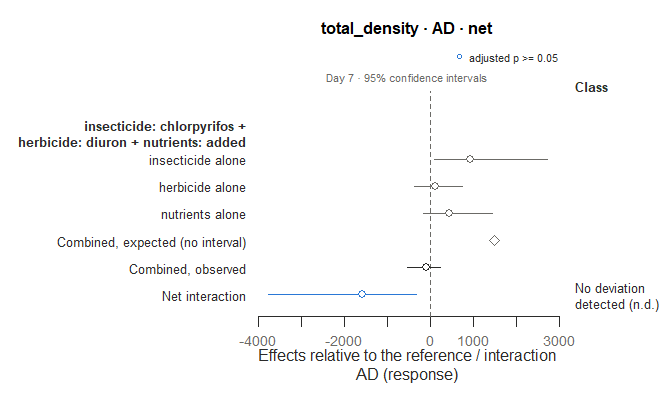

# must

**must** (*MUltiple STressors*) detects and classifies non-additive
effects of multiple stressors in experiments. It makes explicit the
three decisions behind any claim of synergism or antagonism:

1.  **What the design can identify.**
    [`describe_design()`](https://pabloamadorc.github.io/must/reference/describe_design.md)
    reports missing treatment combinations, cells shared by several
    contrasts, the replication unit, stressors applied to whole groups
    of units (blocks, whole plots, rooms) and repeated measures, and
    which interactions are identifiable, before any model is fitted.
2.  **Which model fits the data.**
    [`fit_responses()`](https://pabloamadorc.github.io/must/reference/fit_responses.md)
    fits a generalised linear mixed model (glmmTMB) to each response and
    chooses its error distribution by convergence, simulation-based
    residual checks (DHARMa) and AIC.
3.  **What “non-additive” means.**
    [`estimate_interactions()`](https://pabloamadorc.github.io/must/reference/estimate_interactions.md)
    tests each combination of stressors against one or more null models
    with the same criteria, from the predictions of a single model
    (post-estimation inference, Madge Pimentel et al. 2025), by default
    with a correction for experiments with few replicates. The model is
    the one chosen by
    [`fit_responses()`](https://pabloamadorc.github.io/must/reference/fit_responses.md)
    or one fitted with another package
    ([`lm()`](https://rdrr.io/r/stats/lm.html),
    [`glm()`](https://rdrr.io/r/stats/glm.html),
    [`mgcv::gam()`](https://rdrr.io/pkg/mgcv/man/gam.html), lme4,
    glmmTMB and others, through emmeans). The default null model is
    simple addition (AD), the one that flagged the fewest false
    interactions across mechanisms in simulations; the multiplicative
    (MU) and dominance (DO) models, Bliss independence (BL), with the
    emergent three-way interaction of Beppler et al. (2016), the stress
    addition model (SAM) of Liess et al. (2016) and concentration
    addition (CA, Loewe additivity) are chosen in `null_models`, by name
    or with
    [`suggest_null_models()`](https://pabloamadorc.github.io/must/reference/suggest_null_models.md),
    which applies the guidelines of Schäfer & Piggott (2018) to what is
    known about the stressors. With three or more stressors it separates
    the net deviation from the single-stressor effects from the pure
    highest-order interaction.
    [`classify_interactions()`](https://pabloamadorc.github.io/must/reference/classify_interactions.md)
    gives the directional classes of Piggott et al. (2015).

[`report_interactions()`](https://pabloamadorc.github.io/must/reference/report_interactions.md)
then writes the methods of the analysis, with the works cited, and a
table of every decision behind it, from the settings of the objects.

Orr et al. (2020) name the use of null models as a major unresolved
issue in multiple-stressor research and ask researchers to know the
alternatives and how each relates to a statistical test; must is built
to report them side by side.

> **Status:** version 0.3.0, not yet on CRAN. The interface may still
> change.

The website, <https://pabloamadorc.github.io/must/>, has the help pages,
the vignettes and the case studies.

## Installation

``` r

# install.packages("remotes")
remotes::install_github("pabloamadorc/must")
# The residual checks used to choose each model need DHARMa:
install.packages("DHARMa")
```

## Example

`polazzo_zooplankton` holds the zooplankton of a mesocosm experiment
with a full factorial of an insecticide, a herbicide and nutrients,
three mesocosms per combination, sampled four times after the pesticide
application (Polazzo & Rico 2021, CC0).

``` r

library(must)
zoo <- polazzo_zooplankton[polazzo_zooplankton$day > 0, ]

design <- describe_design(
  zoo,
  stressors = c("insecticide", "herbicide", "nutrients"),
  control = c(insecticide = "absent", herbicide = "absent", nutrients = "ambient"),
  unit = "mesocosm",
  time = "day"
)
design
#> <must_design> 96 rows, 3 stressors, 8 observed treatment combinations
#> Stressors (control): insecticide (absent), herbicide (absent), nutrients (ambient)
#> Unit: mesocosm | Time: day | By: none | Groups: none
#> Contrast sets: 4 candidate(s), 4 identifiable
#> Checks:
#>   info     Experimental unit: 'mesocosm' (24 units, each in a single
#>            treatment combination).
#>   info     Units per treatment combination: 3.
#>   info     Units are measured repeatedly (4 sampling times; 4 per unit).
#>            Samplings of the same unit are not independent: by default
#>            fit_responses() adds a random intercept per unit, which assumes
#>            the same correlation between any two samplings of a unit;
#>            temporal autocorrelation can be modelled through its `random`
#>            argument.
#>   info     Identifiable contrast sets (net deviation): 3 with 2 stressors;
#>            1 with 3 stressors.
#>   info     4 identifiable set(s) share cells (one cell is used by up to 4
#>            sets, typically the control): their estimates are correlated,
#>            not independent replicates of an interaction.
```

One model per response. `residual_checks = TRUE` (the default) uses
DHARMa; it is switched off here only so that this example runs without
it.

``` r

fits <- fit_responses(zoo, c("total_density", "cyclopoida", "daphnia"), design,
                      residual_checks = FALSE, seed = 1, quiet = TRUE)
fits
#> <must_fit> 3 response(s); time structure: interaction; dispersion: common; random effects: (1 | .unit)
#> Residual checks: not run; seed: 1
#>   total_density: gamma_log (log link; continuous, detected), AIC 1311.9, n = 96, missing = 0, residual checks: not run
#>   cyclopoida: tweedie (log link; continuous, detected), AIC 927.8, n = 96, missing = 0, residual checks: not run
#>   daphnia: tweedie (log link; continuous, detected), AIC 410.0, n = 96, missing = 0, residual checks: not run
```

Interactions under the three null models of Madge Pimentel et al. (2025)
(AD alone by default), with Krinsky–Robb intervals and the small-sample
correction (the default):

``` r

est <- estimate_interactions(fits, null_models = c("AD", "MU", "DO"), n_sim = 4000,
                             seed = 2021)
summary(est)
#> Interactions: Krinsky-Robb simulation; small-sample correction; adjusted p-values (BH) below 0.05
#> Deviating / tested interactions by sampling time:
#>       response model estimand   7  14  30  50 overall
#>  total_density    AD      net 0/4 0/4 0/4 0/4     0/4
#>  total_density    MU      net 0/4 0/4 0/4 0/4     0/4
#>  total_density    DO      net 0/3 0/3 0/3 0/3     0/3
#>  total_density    AD     pure 0/1 0/1 0/1 0/1     0/1
#>  total_density    MU     pure 0/1 0/1 0/1 0/1     0/1
#>     cyclopoida    AD      net 0/4 0/4 0/4 0/4     0/4
#>     cyclopoida    MU      net 0/4 0/4 0/4 0/4     0/4
#>     cyclopoida    DO      net 0/3 0/3 0/3 0/3     0/3
#>     cyclopoida    AD     pure 0/1 0/1 0/1 0/1     0/1
#>     cyclopoida    MU     pure 0/1 0/1 0/1 0/1     0/1
#>        daphnia    AD      net 0/1 0/0 0/1 0/1     0/0
#>        daphnia    MU      net 0/1 0/0 0/1 0/1     0/0
#>        daphnia    DO      net 0/1 0/0 0/1 0/1     0/0
#>        daphnia    AD     pure 0/0 0/0 0/0 0/0     0/0
#>        daphnia    MU     pure 0/0 0/0 0/0 0/0     0/0
#> 
#> Classes of the net deviations (Piggott et al. 2015) by sampling time:
#>       response model    7   14   30   50 overall
#>  total_density    AD 4 AD 4 AD 4 AD 4 AD    4 AD
#>  total_density    MU 4 AD 4 AD 4 AD 4 AD    4 AD
#>     cyclopoida    AD 4 AD 4 AD 4 AD 4 AD    4 AD
#>     cyclopoida    MU 4 AD 4 AD 4 AD 4 AD    4 AD
#>        daphnia    AD 1 AD      1 AD 1 AD        
#>        daphnia    MU 1 AD      1 AD 1 AD        
#> 
#> Agreement between null models (AD, MU, DO), robust/model-dependent/conflicting/none:
#>       response estimand       7      14      30      50 overall
#>  total_density      net 0/0/0/4 0/0/0/4 0/0/0/4 0/0/0/4 0/0/0/4
#>  total_density     pure 0/0/0/1 0/0/0/1 0/0/0/1 0/0/0/1 0/0/0/1
#>     cyclopoida      net 0/0/0/4 0/0/0/4 0/0/0/4 0/0/0/4 0/0/0/4
#>     cyclopoida     pure 0/0/0/1 0/0/0/1 0/0/0/1 0/0/0/1 0/0/0/1
#>        daphnia      net 0/0/0/1 0/0/0/0 0/0/0/1 0/0/0/1 0/0/0/0
#>        daphnia     pure 0/0/0/0 0/0/0/0 0/0/0/0 0/0/0/0 0/0/0/0
#> 
#> Counts of boundary tests and of rows not estimated: `$interactions`; classes: `$classes`.
```

The three-stressor set on day 7, with and without the correction
(`correction = "none"` is the asymptotic procedure of Madge Pimentel et
al. 2025):

``` r

asymptotic <- estimate_interactions(fits, n_sim = 4000, seed = 2021, correction = "none")
day7 <- function(x) {
  e <- x$estimates
  e <- e[e$response == "total_density" & e$time == "7" & e$order == 3L &
           e$component == "interaction" & e$null_model == "AD",
         c("estimand", "estimate", "lower", "upper", "df", "p_value", "p_adjusted")]
  e[c("estimate", "lower", "upper")] <- lapply(e[c("estimate", "lower", "upper")], signif, 3)
  e[c("p_value", "p_adjusted")] <- lapply(e[c("p_value", "p_adjusted")], signif, 2)
  rownames(e) <- NULL
  e
}
day7(est)
#>   estimand estimate lower upper df p_value p_adjusted
#> 1      net    -1580 -3770  -320 16   0.023       0.18
#> 2     pure      645 -1120  2800 16   0.410       0.56
day7(asymptotic)
#>   estimand estimate lower upper  df p_value p_adjusted
#> 1      net    -1610 -3020  -650 Inf  0.0025       0.02
#> 2     pure      654  -647  2210 Inf  0.3100       0.42
```

On day 7 the three-stressor combination falls below the sum of the
single effects (`net`), but its pure third-order interaction does not
differ from zero: the net deviation comes mainly from the pairwise
interactions (net = pure + the three pairwise interactions), so it is
not, by itself, evidence of a three-way interaction. With 24 mesocosms
in 8 treatment combinations the correction uses a t distribution with 16
degrees of freedom: the intervals widen and, once adjusted across the
sets and sampling times, the net deviation is no longer significant,
whereas the asymptotic procedure would call it significant. (The
estimates differ slightly because, with random effects, the corrected
ones come from the REML refit.)

[`plot()`](https://rdrr.io/r/graphics/plot.default.html) shows how an
interaction arises: the effect of each stressor alone, the combined
effect that the null model expects from them, the combined effect
observed and the interaction, which is the difference between the last
two, with its class (see below). The three-stressor set on day 7, under
AD:

``` r

trio <- unique(est$estimates$set_id[est$estimates$order == 3L])
plot(est, response = "total_density", time = "7", set_id = trio)
```



`type = "models"` puts the null models side by side,
`type = "interactions"` gives an overview of every set and time, and
`type = "time"` follows a set over the sampling times (see
[`?plot.must_interactions`](https://pabloamadorc.github.io/must/reference/plot.must_interactions.md)).

``` r

cls <- classify_interactions(est)
table(cls$response, cls$class, useNA = "ifany")
#>                
#>                 AD <NA>
#>   cyclopoida    40   20
#>   daphnia        6   54
#>   total_density 40   20
```

“AD” means that no deviation was detected, not that additivity was
shown. `NA` classes are the dominance model, which Table 1 of Piggott et
al. (2015) does not cover, and the sets that need a treatment
combination where the herbicide alone eliminated *Daphnia*: that single
effect is tested from the probability of observing only zeros
(`status = "boundary"`), but the interactions that use it cannot be
measured.

[`report_interactions()`](https://pabloamadorc.github.io/must/reference/report_interactions.md)
writes the methods of this analysis from the settings of the objects;
this is its paragraph on the models:

``` r

report <- report_interactions(est, classes = cls)
cat(strwrap(report$methods[[2]], width = 100), sep = "\n")
#> The analysis was run with the R package must 0.3.0 (Amador Crespo & Rico 2026) in R 4.3.3 (R Core
#> Team 2024). Each response (total_density, cyclopoida and daphnia) was modelled with a generalized
#> linear mixed model with one mean per treatment combination and sampling time (a cell-means model)
#> and a random intercept for each mesocosm, fitted by maximum likelihood with glmmTMB 1.1.8 (Brooks
#> et al. 2017). The error distribution was chosen among candidates suited to the values of each
#> response (Gaussian (identity link), Gaussian (log link), Gamma (log link) and lognormal (log link),
#> for total_density; Gaussian (identity link), Gaussian (log link) and Tweedie (log link), for
#> cyclopoida and daphnia): the candidate that converged with a positive-definite Hessian and had the
#> lowest AIC was selected. The models selected were Gamma (log link) for total_density; Tweedie (log
#> link) for cyclopoida and daphnia. The means of the treatment combinations with only zeros (6 for
#> daphnia) were fixed at the boundary of the link function; a contrast that compares such a
#> combination with its expectation was tested from the probability of observing only zeros under that
#> expectation, and contrasts that need such a combination to compute it were not estimated. For the
#> inference, the selected models were refitted by restricted maximum likelihood (REML).
```

`report$decisions` lists every decision with its argument, the value
used, its default and its source, and
`format(report, format = "markdown")` gives the paragraphs, the table
and the references for an R Markdown or Quarto document.

## Methods and decisions

| Null model | “No interaction” means | Interaction estimate (two stressors) |
|----|----|----|
| AD, simple addition | changes add up on the response scale | yAB − yA − yB + y0 |
| MU, multiplicative | relative changes multiply | ln yAB − ln yA − ln yB + ln y0 |
| DO, dominance | the strongest single effect prevails | min(yAB, y0) − min(yA, yB) |
| BL, Bliss independence | relative responses w = y / y0 multiply | wAB − wA wB |
| SAM, stress addition | the general stresses of the stressors add up | wAB − wSAM |
| CA, concentration addition | each stressor acts as a dilution of the others | wAB − wCA |

- **Choosing the null models.**
  [`suggest_null_models()`](https://pabloamadorc.github.io/must/reference/suggest_null_models.md)
  follows the guidelines of Schäfer & Piggott (2018, Fig. 3): whether
  the stressors act similarly, whether one acts specifically on
  physiology, whether the effect is mortality, whether the
  stressor-effect relationship or the sensitivity distribution is known,
  how the sensitivities are correlated, and how large the effects of the
  stressors alone are relative to the effect limit (given, or estimated
  from the fitted model with their intervals). Unknown criteria take
  every value, so that it returns the range of null models that the
  guidelines allow, with the reasons for each; the result goes to
  `estimate_interactions(null_models = )`. Stressors may also increase
  the response: their effects keep their sign, each set gets the
  interaction type of Piggott et al. (2015), and a proportion that the
  stressors increase is judged on its complement.
- **Default null model.** AD. In simulated experiments generated without
  interaction by AD, MU (or BL), DO, SAM or CA, each null model flagged
  interactions at about the nominal rate when the data followed its own
  mechanism, but none was robust to all; AD flagged the fewest false
  interactions on average among the null models that two-level
  factorials can test (20%, against 24% for MU and BL, 27% for SAM and
  32% for DO), with a rule fixed before the simulations. Data generated
  by stress addition looked synergistic to every other null model. CA
  was more robust still in dose designs, which it needs. The simulation
  is installed with the package
  (`system.file("simulations", package = "must")`). Name the null model
  of a mechanistic hypothesis in `null_models`; with several,
  [`compare_null_models()`](https://pabloamadorc.github.io/must/reference/compare_null_models.md)
  tells which interactions all of them flag (`"robust"`), which only
  some (`"model_dependent"`) and which they flag in opposite directions
  (`"conflicting"`).
- **Equivalence.** “AD” means only that no deviation was detected. With
  an equivalence margin declared before the analysis (`margin`, no
  default), each interaction is also tested for equivalence (two
  one-sided tests on its relative deviation, (observed − expected) /
  reference, the same scale for every null model), and
  [`classify_interactions()`](https://pabloamadorc.github.io/must/reference/classify_interactions.md)
  tells deviations, negligible deviations, equivalence and inconclusive
  results apart.
- **Estimands.** For k ≥ 3 stressors, `net` = yK − Σ yi + (k − 1) y0 (or
  on the log scale) and `pure` = inclusion–exclusion over all 2^k
  combinations; under BL, `net` = wK − Π wi and, for three stressors,
  `pure` is the emergent interaction of Beppler et al. (2016), with
  their rescaled value reported as a description of size. SAM and CA
  give the net interaction only, and CA needs at least two doses of each
  stressor tested alone. DO is defined for two stressors only. By
  default, interactions are estimated with the other stressors at
  control; `background = "all"` in
  [`describe_design()`](https://pabloamadorc.github.io/must/reference/describe_design.md)
  also estimates them in the presence of the others.
- **Inference.** Krinsky–Robb simulation (as in Madge Pimentel et
  al. 2025) or the delta method (not for DO). By default
  (`correction = "small_sample"`) the covariance comes from a REML refit
  and the sampling distribution is a t with the degrees of freedom of
  the experimental units (column `df`); `correction = "none"` reproduces
  the asymptotic procedure. p-values are adjusted with
  Benjamini–Hochberg across contrast sets and sampling times; averages
  over times (`time = "overall"`) are adjusted separately, and
  pre-treatment samplings declared in `baseline` are not tested.
- **Responses.** Counts, continuous values with or without zeros
  (Tweedie), successes out of a number of trials (`trials`) and counts
  per unit of effort (`offset`); one dispersion for all, per `by` group
  or per treatment combination (`dispersion`). A combination with only
  zeros is tested from the probability of that outcome under the null
  model.
- **Reporting.**
  [`report_interactions()`](https://pabloamadorc.github.io/must/reference/report_interactions.md)
  writes the methods from the settings of the objects (design, model
  selection, null models and the criteria behind them, inference and
  classes), with the works cited, and a table with every decision: the
  argument that controls it, the value used, its default and whether it
  was the default, set by the user, chosen by must or estimated.
- **Models fitted outside must.** `estimate_interactions(model, design)`
  takes the means of the treatment combinations from emmeans and applies
  the same contrasts and tests; the degrees of freedom are those of
  emmeans or are given in `df`.
- **Assumptions.** Means are conditional on random effects at zero; MU,
  DO, BL, SAM and CA assume that an increase in the response means
  tolerance (declare the responses where it means sensitivity in
  `sensitivity`); a random intercept per unit does not model temporal
  autocorrelation (an AR1 structure can be given in `random`); selection
  of the error distribution is not included in the uncertainty.

[`vignette("must")`](https://pabloamadorc.github.io/must/articles/must.md)
walks through these decisions in more detail, and
[`vignette("mesocosms")`](https://pabloamadorc.github.io/must/articles/mesocosms.md)
applies the whole workflow to the two mesocosm experiments whose data
come with the package (Polazzo & Rico 2021; Hermann et al. 2024). The
[case
studies](https://pabloamadorc.github.io/must/articles/case-studies.html)
of the website reanalyse six published experiments with other designs,
whose data also come with the package, from drought and plant invasion
on field plots in blocks to five global changes on split plots.

## Status of the checks

- Verified against independent results: cell means and delta-method
  standard errors for Gaussian and Poisson models (hand calculations);
  with the small-sample correction, the AD intervals of a Gaussian model
  equal those of [`lm()`](https://rdrr.io/r/stats/lm.html);
  Welch–Satterthwaite degrees of freedom with one dispersion per
  combination; the probability of a combination with only zeros (closed
  forms and numerical integration); the dominance estimate; the identity
  *net = pure + pairwise interactions* for three stressors; the Bliss
  net and emergent interactions and their rescaled values (eqs. 2.1–2.4
  of Beppler et al. 2016); the stress addition model (eqs. 2–5 of Liess
  et al. 2016); concentration addition (no interaction in data that
  follow it, log-logistic fits equal to
  [`nls()`](https://rdrr.io/r/stats/nls.html)); for models fitted
  outside must, the interaction coefficients and tests of
  [`lm()`](https://rdrr.io/r/stats/lm.html),
  [`glm()`](https://rdrr.io/r/stats/glm.html),
  [`mgcv::gam()`](https://rdrr.io/pkg/mgcv/man/gam.html), glmmTMB and
  lme4 models; the 45 rows of Table 1 of Piggott et al. (2015); and the
  seven steps of Fig. 3 of Schäfer & Piggott (2018), with the effects of
  the stressors alone and their intervals.
- Type I error and power in simulated 2 × 2 experiments (Gaussian,
  Gamma, negative binomial and Poisson models, with and without repeated
  measures). With three replicates per combination, the asymptotic tests
  rejected a true null model in 10–17% of the experiments (Gaussian AD
  12.8%, Gamma MU 13.5%, negative binomial MU 10.3%, Gaussian DO 16.5%)
  and the corrected ones in 2–7%; Poisson tests, without a dispersion
  parameter, are the same either way.
- Tried on 36 published multiple-stressor data sets with different
  designs (full and partial factorials with two to twelve stressors,
  gradients, checkerboards, blocks, split plots, repeated measures,
  pre-treatment samplings, a stressor applied later than the others,
  controls shared by several groups or orders of application, survival
  out of a number of animals, counts per unit of effort, sequential
  exposures): the description of each design matches an independent
  tabulation of the original files, and the results that do not depend
  on the model (raw cell means, net deviations as sums of pure
  interactions) agree; 143 checks, all passed.
- `R CMD check` runs on Linux, macOS and Windows with GitHub Actions,
  including the DHARMa residual checks.

## References

Beppler, C., Tekin, E., Mao, Z., White, C., McDiarmid, C., Vargas, E.,
Miller, J. H., Savage, V. M., & Yeh, P. J. (2016). Uncovering emergent
interactions in three-way combinations of stressors. *Journal of the
Royal Society Interface*, 13, 20160800.
<https://doi.org/10.1098/rsif.2016.0800>

Hermann, M., Polazzo, F., Cherta, L., Crettaz-Minaglia, M.,
García-Astillero, A., Peeters, E. T. H. M., Rico, A., & Van den Brink,
P. J. (2024). Combined stress of an insecticide and heatwaves or
elevated temperature induce community and food web effects in a
Mediterranean freshwater ecosystem. *Water Research*, 260, 121903.
<https://doi.org/10.1016/j.watres.2024.121903>. Data:
<https://doi.org/10.5281/zenodo.11520459> (CC BY 4.0).

Liess, M., Foit, K., Knillmann, S., Schäfer, R. B., & Liess, H.-D.
(2016). Predicting the synergy of multiple stress effects. *Scientific
Reports*, 6, 32965. <https://doi.org/10.1038/srep32965>

Madge Pimentel, I., Albini, D., Beermann, A. J., Leese, F., Macaulay, S.
J., Matthaei, C. D., Orr, J. A., Piggott, J. J., & Schäfer, R. B.
(2025). Hypothesis-driven research on multiple stressors: An analytical
framework for stressor interactions. *Ecology and Evolution*, 15,
e71959. <https://doi.org/10.1002/ece3.71959>

Orr, J. A., Vinebrooke, R. D., Jackson, M. C., Kroeker, K. J., Kordas,
R. L., Mantyka-Pringle, C., Van den Brink, P. J., De Laender, F., Stoks,
R., Holmstrup, M., Matthaei, C. D., Monk, W. A., Penk, M. R., Leuzinger,
S., Schäfer, R. B., & Piggott, J. J. (2020). Towards a unified study of
multiple stressors: Divisions and common goals across research
disciplines. *Proceedings of the Royal Society B*, 287, 20200421.
<https://doi.org/10.1098/rspb.2020.0421>

Piggott, J. J., Townsend, C. R., & Matthaei, C. D. (2015).
Reconceptualizing synergism and antagonism among multiple stressors.
*Ecology and Evolution*, 5(7), 1538–1547.
<https://doi.org/10.1002/ece3.1465>

Polazzo, F., & Rico, A. (2021). Effects of multiple stressors on the
dimensionality of ecological stability. *Ecology Letters*, 24(8),
1594–1606. <https://doi.org/10.1111/ele.13770>. Data:
<https://doi.org/10.5061/dryad.qfttdz0gt> (CC0 1.0).

Schäfer, R. B., & Piggott, J. J. (2018). Advancing understanding and
prediction in multiple stressor research through a mechanistic basis for
null models. *Global Change Biology*, 24(5), 1817–1826.
<https://doi.org/10.1111/gcb.14073>

## License

MIT © Pablo Amador Crespo
